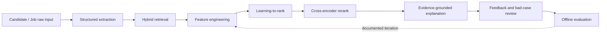
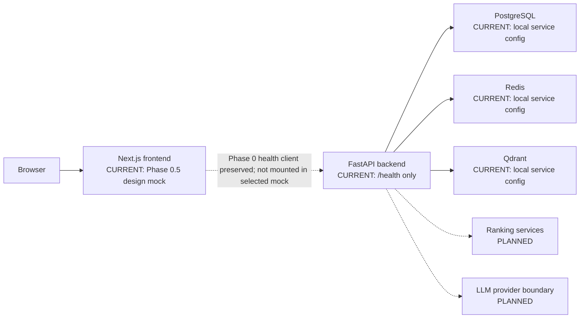

# PeopleMatch Agent

**PeopleMatch Agent：AI Builder 人岗匹配与推荐解释系统**

PeopleMatch Agent is an autonomous, local-running prototype for evidence-aware candidate/job matching. It is designed to evolve beyond keyword search into a traceable pipeline that can rank AI Builder opportunities, explain why a match is supported by project evidence, review bad cases, and compare later algorithms through sandbox-only offline evaluation.

The repository has completed **Phase 1 — Dataset & Schema**. Phases 0, 0.5, and 1 are frozen; Phase 2 remains planned. Dataset `1.0.0` provides canonical Pydantic data contracts, synthetic sandbox profiles, curated relevance labels, query-level splits, and a deterministic freeze manifest. Matching, ranking, LLM, retrieval, persistence, feedback, and evaluation capabilities shown in the roadmap remain planned—not implemented.

## Project Overview

The intended product answers more than “do these texts contain similar skills?” It separates a claimed skill from evidence that a person used it, distinguishes semantic similarity from role-direction fit, keeps constraints such as location and seniority visible, and makes each later recommendation traceable to ranking evidence.

The complete product direction covers:

- evidence-aware candidate and job profiles;
- retrieval, scoring, ranking, and reranking;
- recommendation explanations grounded in ranking evidence;
- feedback and bad-case review without silently changing prior results;
- reproducible offline evaluation on local sandbox datasets.

## Problem Statement

Conventional keyword matching is an incomplete basis for AI hiring decisions:

- A skill keyword is not proof of project experience or delivery depth.
- Semantic similarity does not guarantee the same role direction or day-to-day work.
- Strong technical similarity can still conflict with location, seniority, or team-stage constraints.
- A recommendation score alone does not reveal why a bad case occurred or which pipeline stage caused it.

PeopleMatch Agent is planned around explicit evidence, separable ranking stages, and evaluation traceability so later improvements can be compared rather than asserted.

## Product Users

- **Candidate / AI Builder:** understands how experience maps to a role and which evidence supports or weakens a fit.
- **Recruiter / Founder / Hiring Team:** reviews ranked matches, constraints, and grounded reasons without treating semantic similarity as the final decision.
- **Platform Operator:** traces match runs, investigates bad cases, manages sandbox labels, and compares offline evaluation runs.

## Planned Matching Pipeline

The following is the target sequence. Every stage is planned for a later phase.



Phase 0 implements none of these algorithmic stages. It only defines their future boundaries.

## Architecture Overview



The health endpoint is liveness-only and intentionally does not fail when infrastructure is unavailable. Dependency readiness will be added separately in a later phase.

## Repository Structure

```text
peoplematch-agent/
├── backend/                  # FastAPI app, API tests, Alembic foundation
│   ├── app/
│   │   ├── api/              # Routers, routes, unified error handlers
│   │   ├── core/             # Settings and standard logging
│   │   ├── middleware/       # Request ID tracing
│   │   ├── models/           # Empty SQLAlchemy metadata root
│   │   ├── schemas/          # Shared API envelopes
│   │   └── services/         # Documented future domain boundaries
│   ├── alembic/              # Migration environment; no domain revisions yet
│   └── tests/                # Deterministic API tests
├── frontend/                 # Next.js App Router frontend
│   └── src/
│       ├── app/              # Layout, page, and global styles
│       ├── components/       # Reusable presentational components
│       ├── features/         # Feature-oriented system status integration
│       ├── lib/              # Typed backend client
│       └── types/            # Shared frontend API types
├── data/                     # Phase 1 sandbox profiles, labels, schemas, split, and manifest
├── docs/                     # PRD, architecture, API plan, roadmap
├── infra/docker/             # Docker-specific notes and future assets
├── postman/                  # Future API collections
├── scripts/                  # Future focused developer scripts
└── screenshots/              # Future verified product captures
```

## Current Phase

**Phase 1 — Dataset & Schema (Completed)**

Phase 1 defines versioned candidate, job, project-evidence, relevance-label, and pairwise-preference contracts. The frozen dataset `1.0.0` contains synthetic sandbox profiles and `synthetic_curated` labels with a fixed job-query split. JSON Schemas, descriptive statistics, the future seed manifest, and `data/eval/dataset_freeze_manifest.json` are deterministic. The five test queries `job_020` through `job_024` are frozen and must not be tuned against future model output.

Phase 0.5A completed the information architecture, user flows, page hierarchy, design-system direction, screenshot planning, and three-way visual exploration. Phase 0.5B implemented the user-selected Evidence-first fusion for the Matching Results hero screen. Its shortlist values, score breakdowns, evidence records, risk labels, and trace remain marked `Design Mock`; they do not come from the Phase 1 dataset or a matching engine.

Phase 0 completed:

- product definition, PRD, architecture, API inventory, and Phase 0–12 roadmap;
- FastAPI application factory, environment settings, CORS, logging, and Swagger docs;
- `GET /health` with a typed API envelope and generated/propagated `X-Request-ID`;
- consistent 404, validation, and application-error response envelopes;
- deterministic backend API tests with no external-service dependency;
- minimal responsive Next.js shell with a real backend health request;
- frontend loading, healthy, unavailable, and retry states;
- Docker Compose definitions for PostgreSQL, Redis, Qdrant, backend, and frontend;
- an Alembic foundation connected to empty SQLAlchemy metadata.

Not implemented: database persistence, candidate/job parsers, matching algorithms, LLM calls, vector retrieval, feature scoring, ranking, explanations, feedback workflows, evaluation metrics, or a complete dashboard.

## Roadmap

| Phase | Direction | Status |
|---|---|---|
| 0 | Product definition and engineering bootstrap | Completed |
| 0.5 | Product design and UI system | Completed |
| 1 | Sandbox dataset, canonical contracts, and ranking labels | Completed |
| 2 | Candidate/job persistence and migrations | Planned |
| 3 | Profile extraction implementation | Planned |
| 4 | Hybrid retrieval | Planned |
| 5 | Evidence-aware feature scoring | Planned |
| 6 | Learning-to-rank | Planned |
| 7 | Cross-encoder reranking | Planned |
| 8 | Match-run orchestration and traceability | Planned |
| 9 | Evidence-grounded explanations | Planned |
| 10 | Feedback and bad-case review | Planned |
| 11 | Offline evaluation | Planned |
| 12 | Local prototype hardening and documented demo | Planned |

See [development-roadmap.md](docs/development-roadmap.md) for dependencies and quality gates.

## Local Development

### Prerequisites

- Docker Desktop with Docker Compose v2 for the full environment
- Python 3.9+ for native backend development (the backend image uses Python 3.11)
- Node.js 22 LTS and npm 10+ for native frontend development

### Full environment with Docker Compose (PowerShell)

From the repository root:

```powershell
Copy-Item .env.example .env
docker compose up --build
```

Open:

- Frontend: <http://localhost:3000>
- API: <http://localhost:8000>
- FastAPI docs: <http://localhost:8000/docs>
- Qdrant HTTP API: <http://localhost:6333>

Verify the backend in another PowerShell window:

```powershell
Invoke-RestMethod -Uri http://localhost:8000/health
```

Stop the environment without deleting named volumes:

```powershell
docker compose down
```

### Backend without Docker (PowerShell)

The Phase 0 backend does not require infrastructure to serve liveness:

```powershell
python -m venv backend\.venv
& .\backend\.venv\Scripts\python.exe -m pip install -r backend\requirements.txt
Set-Location backend
& .\.venv\Scripts\python.exe -m uvicorn app.main:app --reload --host 0.0.0.0 --port 8000
```

### Frontend without Docker (PowerShell)

Run this in a separate PowerShell window:

```powershell
Set-Location frontend
npm ci
$env:NEXT_PUBLIC_API_BASE_URL = "http://localhost:8000"
npm run dev
```

The Phase 0.5B root screen is a frontend-only `Design Mock` and does not call the backend. Backend liveness remains independently available at <http://localhost:8000/health>; the Phase 0 health client/status component is preserved but is not mounted in the selected Matching Results screen.

## Testing

Backend tests from the repository root:

```powershell
$env:PYTEST_DISABLE_PLUGIN_AUTOLOAD = "1"
& .\backend\.venv\Scripts\python.exe -m pytest backend\tests -v
```

Phase 1 data checks from the repository root:

```powershell
& .\backend\.venv\Scripts\python.exe scripts\export_json_schemas.py
& .\backend\.venv\Scripts\python.exe scripts\validate_dataset.py
& .\backend\.venv\Scripts\python.exe scripts\dataset_stats.py
& .\backend\.venv\Scripts\python.exe scripts\prepare_seed_bundle.py
& .\backend\.venv\Scripts\python.exe scripts\freeze_dataset.py
```

Frontend checks:

```powershell
Set-Location frontend
npm test
npm run lint
npm run typecheck
npm run build
```

Compose validation:

```powershell
docker compose config
```

## API Liveness Contract

`GET /health` returns HTTP 200 without checking downstream readiness:

```json
{
  "success": true,
  "data": {
    "status": "ok",
    "service": "peoplematch-backend",
    "version": "0.1.0",
    "environment": "development"
  },
  "error": null,
  "request_id": "generated-or-propagated-id"
}
```

Supply `X-Request-ID` to propagate a caller trace identifier. Otherwise, the backend generates a UUID and returns it in both the response header and body.

## Data & Privacy

This independent project is limited to:

- synthetic or sandbox data;
- public job-description examples;
- curated synthetic labels for small local evaluation datasets.

It does not ingest private candidate data or claim integration with recruitment platforms, employers, or ATS products.

## Evaluation Policy

Future Recall, NDCG, MRR, or related measurements may only come from reproducible local sandbox offline evaluation. Each result must identify its dataset, labels, split, configuration, and limitations. Offline results must never be described as online user or business impact.

## Project Status

Local prototype foundation under active development. This repository is not a production deployment, recruitment marketplace, or production-hardened service. There are no claims of users, traffic, commercial impact, online experiments, or production performance.
