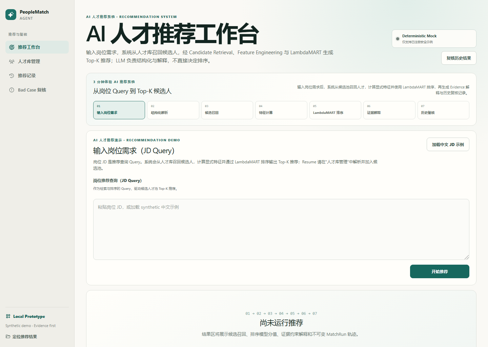
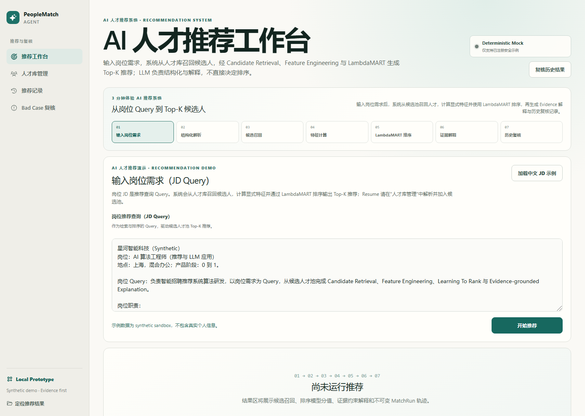
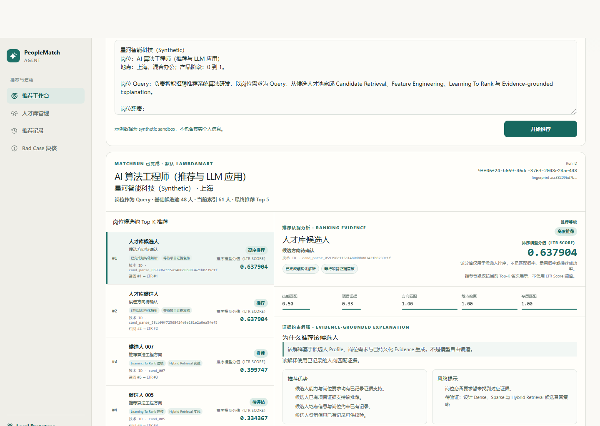
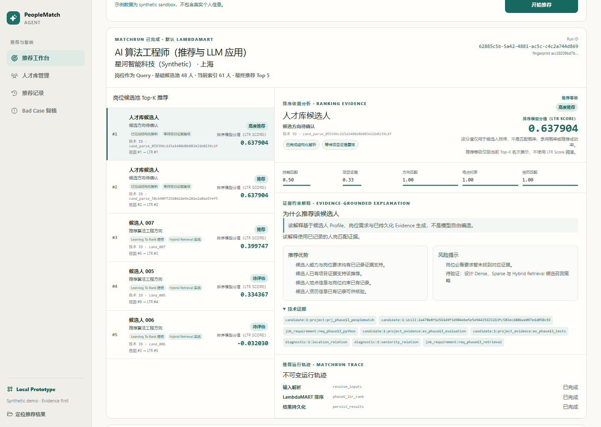
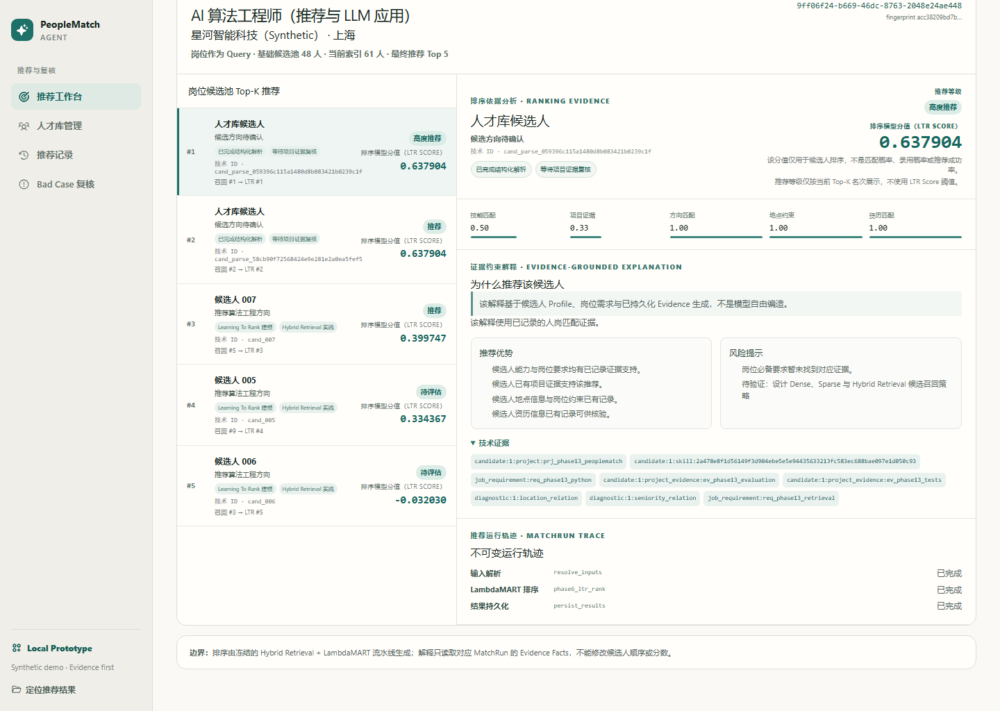
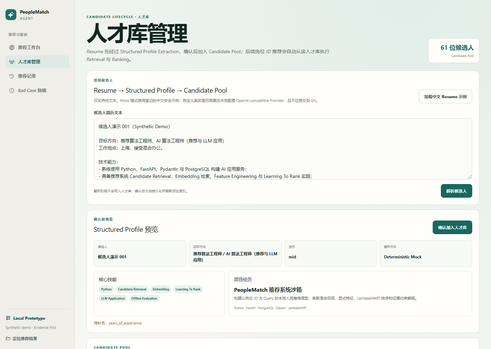
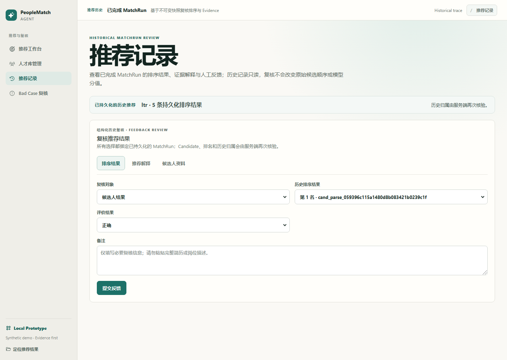
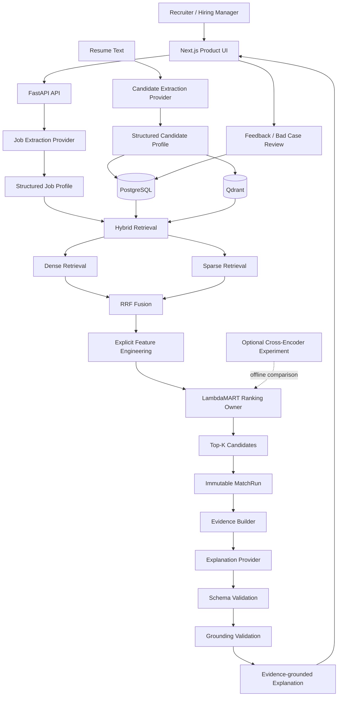

# PeopleMatch Agent

## Evidence-grounded AI Talent Matching System

> PeopleMatch Agent is an AI-powered talent matching system combining LLM extraction, Hybrid Retrieval, Learning-to-Rank and Evidence-grounded Explanation.

一个面向技术招聘场景的 AI 人才推荐系统：招聘者输入岗位描述（JD Query），系统理解岗位要求，从候选人才库中召回候选人，使用 LambdaMART 完成 Top-K 排序，再基于已记录的 Evidence 生成可审计解释。

**LLM understands. Retrieval finds. LambdaMART ranks. Evidence keeps explanations grounded.**

[快速体验](#本地运行) · [系统架构](docs/portfolio/architecture.md) · [工程决策](docs/portfolio/engineering-decisions.md) · [离线评估](docs/offline-evaluation.md) · [面试讲解](docs/portfolio/interview-guide.md)



> 当前状态：完整本地 AI Application Prototype。默认 deterministic mock 便于复现；同时支持 OpenAI-compatible Provider。项目不声称已形成生产 SaaS、真实用户规模或线上招聘效果。

## Three Key Ideas

| 职责 | 系统组件 | 设计目的 |
| --- | --- | --- |
| **LLM understands** | JD / Resume Structured Extraction | 将非结构化文本转换为可验证的 Profile；LLM 不决定最终排名 |
| **Retrieval finds** | Dense + Sparse + RRF Hybrid Retrieval | 同时覆盖语义相关性与技术关键词精确匹配 |
| **Ranking decides** | Explicit Features + LambdaMART | 以稳定、可评估、可复现的方式决定 Candidate ordering |

解释生成与排序严格解耦：Explanation 只能读取 MatchRun 中已有的 Evidence，不能修改 Candidate order、LTR Score 或历史结果。

## Product Walkthrough

### 1. JD-first 推荐：岗位是 Query，人才库是搜索空间

默认 deterministic Mock Mode 使用已登记的 synthetic JD fixtures，保证本地演示与测试可复现；配置 OpenAI-compatible Real Provider 后，推荐入口支持用户输入新的岗位 JD。两种模式均复用 Candidate Pool → Retrieval → LambdaMART → Explanation 流程，“加载示例 JD”只是辅助入口。



### 2. Top-K Candidate Ranking

候选人顺序由冻结的 Hybrid Retrieval + Feature Engineering + LambdaMART 流水线产生。页面保留排序模型原始分值（LTR Score），并明确它**不是匹配概率、录用概率或百分比评分**。



### 3. Evidence-grounded Explanation

每条解释绑定 Candidate Evidence、Job Requirement 与校验状态。真实 Provider 输出需要依次通过 Schema Validation 与 Grounding Validation；不受支持的陈述会被拒绝或进入受约束修复，而不是直接展示。



<details>
<summary><strong>查看更多真实产品界面</strong></summary>

#### MatchRun Trace

MatchRun 保存推荐运行、ranking provenance 与 evidence projection，支持历史结果复核。当前 UI 展示的是已持久化阶段，而不是伪造的全链路日志。



#### Candidate Lifecycle

Resume Text 可以通过现有 extraction contract 生成 Structured Candidate Profile。截图停留在确认前的预览阶段，没有向冻结候选池写入数据。



#### Feedback Review

截图展示已完成 MatchRun 的人工评价表单：反馈绑定历史结果，不会重写原始候选顺序，也不会自动污染训练标签。Bad Case Review 是独立复核能力，本图不将其冒充为已展示页面。



</details>

完整截图说明见 [Portfolio Overview](docs/portfolio/overview.md)。

## Problem & Product Design

技术招聘中的人才匹配不是简单的关键词搜索：

- JD 与简历都是非结构化文本，表达方式不一致；
- 纯关键词检索容易漏掉语义相关能力；
- 纯向量相似度缺少业务约束和明确特征；
- 让 LLM 直接打分或排序，难以稳定复现与离线评估；
- 生成式解释可能脱离候选人事实，形成招聘风险。

PeopleMatch Agent 因此采用职责分离的 AI 系统：LLM 负责理解与表达，Retrieval 负责缩小搜索空间，LambdaMART 负责排序，Evidence Contract 负责约束解释，MatchRun 负责追踪与复核。

## System Architecture



### Ranking ownership

- **LLM**：Job / Resume Structured Extraction、Evidence-grounded Explanation。
- **Hybrid Retrieval**：Dense semantic recall + Sparse keyword recall + RRF fusion。
- **Feature Engineering**：构造语义、关键词、技能、项目证据、方向、地点、资历、缺失项与 overclaim 等显式特征。
- **LambdaMART**：默认且唯一的最终 ranking owner。
- **Cross-Encoder**：可选离线实验；冻结评估未证明优于 LambdaMART，因此不作为默认方案。
- **Evidence / Validation**：限制解释可以说什么；不能改变排序。

更多细节见 [Architecture Deep Dive](docs/portfolio/architecture.md)。

## Evidence-grounded Explanation

普通的 LLM 推荐容易把“语言流畅”误当成“事实可靠”。本项目采用 fail-closed 解释链路：

```text
MatchRun Evidence projection
        ↓
Explanation planning
        ↓
ExplanationPlanV1 schema validation
        ↓
Evidence grounding validation
        ↓
Constrained repair（仅修复允许的结构/引用问题）
        ↓
Validated explanation
```

核心约束：

- strengths 必须引用 Candidate Evidence；
- risks / interview questions 必须来自已记录的 missing requirement 或合法 evidence；
- repair output 只能规范化白名单结构，不能创造 candidate facts；
- unknown evidence reference 与 hallucinated evidence 必须 fail closed；
- explanation 前后 Candidate ordering、LTR Score 与 ranking fingerprint 保持不变。

## Offline Evaluation

Phase 11 使用冻结的 synthetic curated dataset 进行描述性离线评估。

### Retrieval — Test R1

| Method | Recall@5 | Recall@10 | Recall@20 |
| --- | ---: | ---: | ---: |
| Dense | 0.42 | 0.42 | 0.70 |
| Sparse | 0.67 | 0.80 | 0.95 |
| Hybrid | 0.47 | 0.66 | 0.90 |

### Ranking — Test R2

| Method | NDCG@5 | NDCG@10 | MRR@10 | Pairwise |
| --- | ---: | ---: | ---: | ---: |
| Hybrid baseline | 0.7920 | 0.8343 | 0.90 | 0.80 |
| **LambdaMART** | **0.9593** | **0.9597** | **1.00** | **1.00** |
| Optional Cross-Encoder | 0.8991 | 0.9212 | 1.00 | 0.90 |

> **必须同时阅读的边界：** 这些是 synthetic sandbox 的离线描述性结果，不是招聘准确率，也不能推断真实业务提升。冻结数据包含 24 个 Jobs、48 个 Candidates 与 288 条显式 judgments；Test 仅 5 个 Jobs，judgment coverage 为 25%，且部分 Test queries 曾在更早阶段暴露。由于不完整 judgments，项目没有把标准 Precision@K 作为正式结论。

其中 **48 Candidates** 是 Phase 11 frozen evaluation base；截图中的 **61 Candidates** 来自当前本地 runtime 对 synthetic profiles 的增量导入与索引，仅用于产品流程演示，不进入 Phase 11 evaluation，也不改变上述冻结指标。

数据、协议、fingerprint 与完整限制见 [Offline Evaluation](docs/offline-evaluation.md) 和 [Dataset Card](docs/dataset-card.md)。

## Engineering Evidence

| Engineering concern | Implemented evidence |
| --- | --- |
| Ranking reproducibility | 冻结 feature order、model metadata、artifact fingerprint 与 deterministic MatchRun |
| Ranking invariance | Provider / explanation 变化不能修改 Candidate ordering、LTR Score 或 ranking fingerprint |
| Provider isolation | Extraction Provider 与 Explanation Provider 保持独立领域边界，共享 OpenAI-compatible transport |
| Prompt provenance | Candidate / Job / Explanation prompts 独立版本化并记录 fingerprint |
| Safe failure | timeout、rate limit、missing config、invalid response 映射为稳定错误；不自动回退到 Mock |
| Traceability | MatchRun 保存输入引用、阶段状态、排名结果与 evidence projection |
| Review loop | Feedback 与 Bad Case 支持人工复核，但不伪装为线上 continuous learning |
| Evaluation integrity | Phase 11 artifacts、dataset split 与结果冻结，变更通过保护审计 |

真实 Provider 边界：Qwen3.7-plus 曾在本地、受控、脱敏的 OpenAI-compatible smoke 中验证 extraction 与 grounded explanation compatibility；该过程不是仓库内可复现的公开 artifact，也不应被解读为公网部署证明。默认 Mock 路径用于 CI、测试与可复现演示。

## Technology Stack

| Layer | Technologies |
| --- | --- |
| Frontend | Next.js, React, TypeScript, CSS Modules |
| Backend | Python 3.11, FastAPI, Pydantic, SQLAlchemy |
| Storage | PostgreSQL, Redis, Qdrant |
| AI / Ranking | Structured LLM extraction, Embeddings, Dense + Sparse + RRF, LightGBM LambdaMART, optional Cross-Encoder, Evidence Grounding |
| Provider | Deterministic Mock, OpenAI-compatible transport, Qwen-compatible configuration |
| Quality | pytest, Vitest, Playwright, ESLint, TypeScript, Docker Compose |

## 本地运行

### 环境要求

- Docker Desktop + Docker Compose
- Node.js 22 LTS 与 npm
- Python 3.11（运行本地测试/脚本时）
- 项目要求的已验证 LambdaMART artifact 与 metadata

> 仓库不把大模型或未授权二进制 artifact 当作普通源码提交。Fresh clone 在启动前必须获得与 metadata / fingerprint 匹配的 ranking artifact；如果 artifact 未提供，系统应 fail closed，而不是回退到假排序。当前交付边界与恢复证据见 [Portfolio Evidence](docs/portfolio-evidence.md)。

### 1. 配置本地环境

```powershell
Copy-Item .env.example .env
```

默认 deterministic mock 不需要 API Key。真实 Provider 只在本地 `.env` 中配置：

```ini
EXTRACTION_PROVIDER=openai_compatible
EXPLANATION_PROVIDER=openai_compatible
LLM_BASE_URL=
LLM_MODEL=
LLM_API_KEY=
```

不要把 `.env` 或真实 API Key 提交到 Git。

### 2. 启动完整应用

```powershell
docker compose up -d --build
docker compose ps
```

访问：

- Frontend: <http://localhost:3000>
- Backend health: <http://localhost:8000/health>
- API docs: <http://localhost:8000/docs>

### 3. 验证

```powershell
Set-Location backend
.\.venv\Scripts\python.exe -m pytest

Set-Location ..\frontend
npm test -- --run
npm run typecheck
npm run lint
npm run build
```

实际 Demo 路径见 [Demo Guide](docs/demo-guide.md)。

## Portfolio Deep Dives

- [Portfolio Overview](docs/portfolio/overview.md) — 产品定位、截图证据与展示边界
- [Architecture](docs/portfolio/architecture.md) — 组件职责、数据流和不可变边界
- [Engineering Decisions](docs/portfolio/engineering-decisions.md) — 为什么不是纯 LLM、为什么使用 LambdaMART
- [Interview Guide](docs/portfolio/interview-guide.md) — 30 秒、2 分钟与 10 分钟讲解路线
- [Portfolio Evidence](docs/portfolio-evidence.md) — 代码、测试、评估与演示证据索引
- [Development Roadmap](docs/development-roadmap.md) — Phase 0–15 的演进记录

## Deployment Status

- **`portfolio-demo`**：面向 GitHub 与面试展示的完整本地运行版本，保留真实 Retrieval → Ranking → Explanation → Review 链路。
- **`cloud-deployment-archive`**：保留 Production Docker、public security boundary、artifact verification 与 Oracle ARM / Cloudflare 的部署准备。
- 公网部署目前暂停，等待外部云资源配置。仓库不声称已提供线上 SaaS、生产 SLA 或真实用户流量。

## 当前边界

- Local AI application prototype，不是 automated hiring decision system。
- Candidate Pool 与 evaluation 数据均为 synthetic / sandbox 数据，不包含真实候选人隐私。
- 离线指标只描述当前冻结数据集，不能代表真实招聘结果。
- 所有推荐应由招聘人员结合面试与背景核验进行人工复核。
- LLM 负责理解与证据约束表达；LambdaMART 始终负责默认最终排序。
