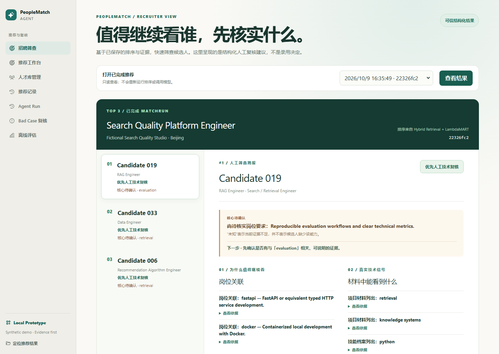
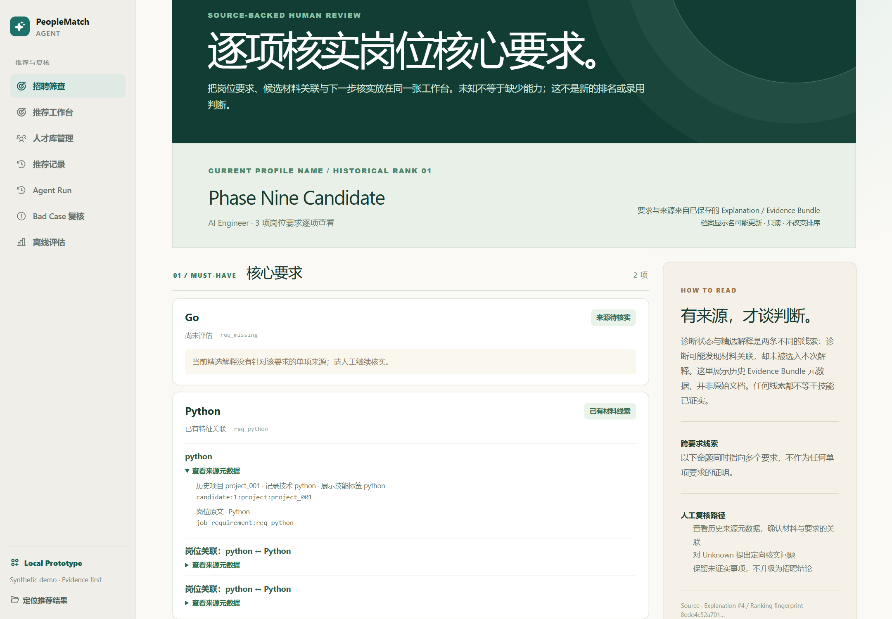
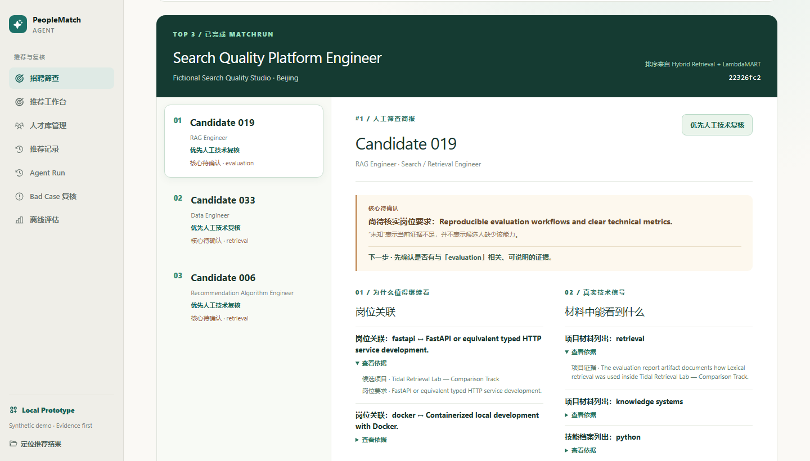
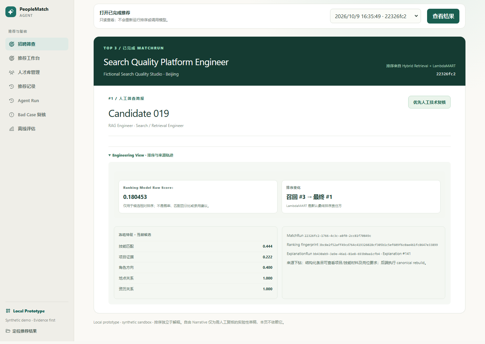
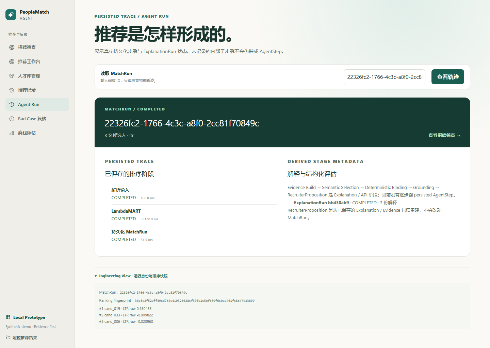
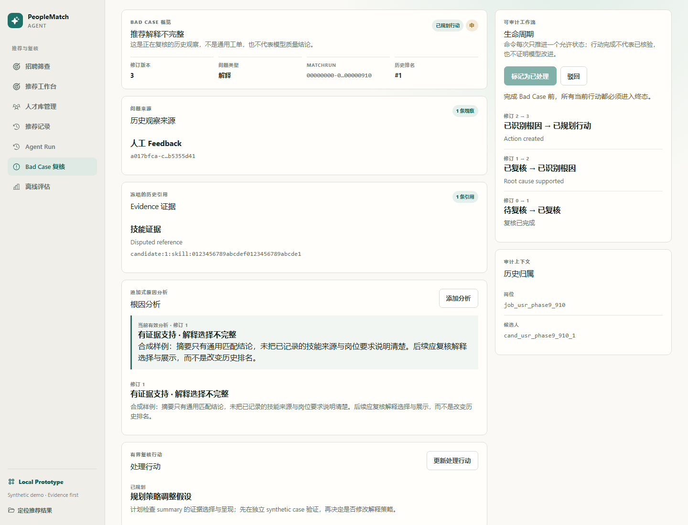
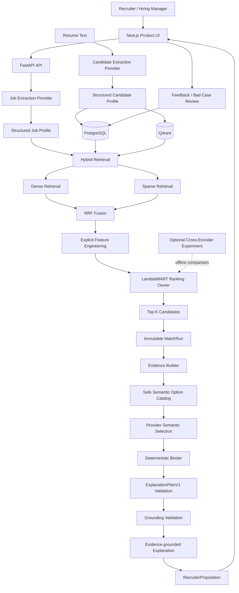
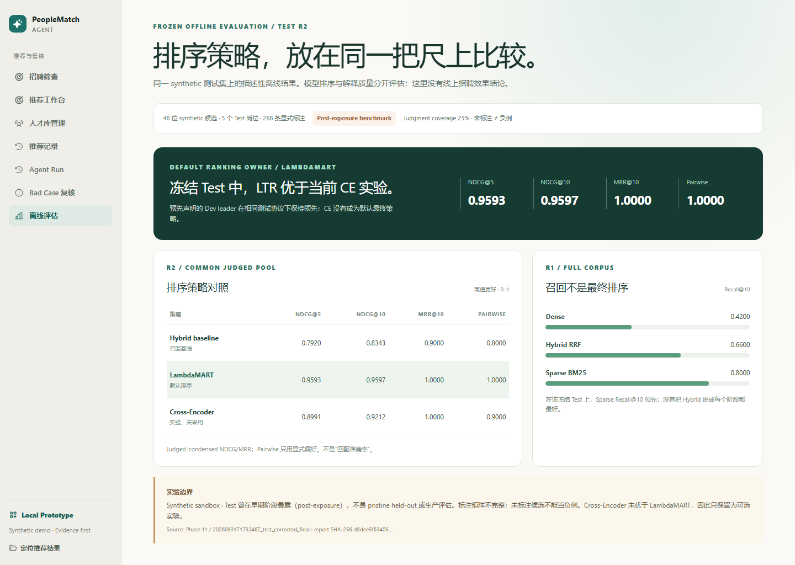

# PeopleMatch Agent

## Evidence-grounded AI Talent Matching System

> PeopleMatch Agent is an AI-powered talent matching system combining LLM extraction, Hybrid Retrieval, Learning-to-Rank and Evidence-grounded Explanation.

一个面向技术招聘场景的 AI 人才推荐系统：招聘者输入岗位描述（JD Query），系统理解岗位要求，从候选人才库中召回候选人，使用 LambdaMART 完成 Top-K 排序，再基于已记录的 Evidence 生成可审计解释。

**LLM understands. Retrieval finds. LambdaMART ranks. Evidence keeps explanations grounded.**

[V5 工作台](#v5-岗位要求核实工作台) · [Public Portfolio](docs/portfolio/v5/PeopleMatch-AI-Native-Engineer-Public-Portfolio.pdf) · [Executive Brief](docs/portfolio/v5/PeopleMatch-AI-Native-Engineer-Public-Executive-Brief.pdf) · [演示指南](docs/demo-guide.md) · [复现层级](docs/v5-reproduction-guide.md)



> 当前状态：完整本地 AI Application Prototype。默认 deterministic mock 便于复现；同时支持 OpenAI-compatible Provider。项目不声称已形成生产 SaaS、真实用户规模或线上招聘效果。

## V5 岗位要求核实工作台

这份源码修订包含只读的 Requirement Review Workbench：招聘人员从已保存的 MatchRun / Explanation 进入，逐项查看 must-have、nice-to-have、候选材料线索、尚待核实的 Unknown 和历史来源元数据。它帮助人决定**下一步核实什么**，不重新排序、不调用 Provider，也不把“没有证据”写成“候选人没有能力”。



后端按历史 Evidence Bundle 与结构化 Proposition 构建投影；`GET /api/v1/match-explanations/{id}/requirement-review` 只返回实际展示命题所使用的候选来源。客户端还会核对 Run、Candidate、Rank、Explanation、指纹和来源闭包：**HTTP 200 可以与可信页面拒绝展示同时成立**。该页面使用的截图来自本地隔离 synthetic 数据库，不是生产招聘记录；[截图来源与验证范围](docs/release/v5-publication/engineering-case.md)。

V5 的关键工程案例是“任务契约 → 后端/前端实现 → 独立代码审查 → 来源归属与闭包修复 → 测试、持久化回读和浏览器验收”。真实 Mission、源码、拒绝性测试和审查结论的入口见 [AI-Native 工程案例](docs/release/v5-publication/engineering-case.md)。代表性 Codex 指令若出现，均标为基于产物的复盘，不是恢复的逐字历史聊天。公开版 [Evidence Pack](docs/portfolio/v5/PeopleMatch-AI-Native-Engineering-Evidence-Pack.zip) 只包含审查过的精选材料，不是数据库转储或完整开发工作区。

复现分三级：[A / 源码与定向测试，B / 独立 synthetic V5 演示，C / 历史 Fresh Trusted Run](docs/v5-reproduction-guide.md)。A、B 的成功不等于历史 Qwen Top-3 重新执行；C 需要对应持久化数据与模型 artifact，普通 clone 不自动恢复。V5 仍是本地原型，未宣称生产招聘效果。

受控 synthetic Fresh Top-3 验证了真实 Provider Extraction / Semantic Selection、3/3 grounded Explanation 与 3/3 canonical RecruiterProposition，并核对了候选隔离、持久化回读和排序不变量；这是本地端到端验证，不是生产招聘效果。自由 Recruiter Narrative 仍为 **Experimental / Requires Human Review**。

## Three Key Ideas

| 职责 | 系统组件 | 设计目的 |
| --- | --- | --- |
| **LLM understands** | JD / Resume Structured Extraction | 将非结构化文本转换为可验证的 Profile；LLM 不决定最终排名 |
| **Retrieval finds** | Dense + Sparse + RRF Hybrid Retrieval | 同时覆盖语义相关性与技术关键词精确匹配 |
| **Ranking decides** | Explicit Features + LambdaMART | 以稳定、可评估、可复现的方式决定 Candidate ordering |

解释生成与排序严格解耦：Explanation 只能读取 MatchRun 中已有的 Evidence，不能修改 Candidate order、LTR Score 或历史结果。

## Product Walkthrough

### 1. 招聘筛查：先看谁值得复核、还缺什么证据

在保存了历史 synthetic Fresh Top-3 的本地演示环境中，Recruiter View 读取已持久化的 MatchRun、Evidence 与结构化 RecruiterProposition，展示复核动作、技术信号、未知和核实目标；普通 fresh clone 不自动拥有这条历史 Run。它不是自动录用建议。新的 JD 可从 `/workbench` 输入；deterministic Mock Mode 仅适用于注册的 synthetic fixture，配置 OpenAI-compatible Provider 后可运行结构化任务。

这张首页截图即上方的 Recruiter View Hero；不会为了展示页面而重新运行 Ranking 或 Provider。

### 2. Evidence-grounded Explanation

每条可信解释绑定 Candidate Evidence、Job Requirement 与校验状态。Phase 9 的真实 Provider 选择候选人范围内的语义对象；程序确定性绑定结构关系，随后通过 ExplanationPlanV1 与 Grounding 校验。非法选择 fail closed，不会作为事实直接展示。



### 3. Top-K Candidate Ranking

候选人顺序由冻结的 Hybrid Retrieval + Feature Engineering + LambdaMART 流水线产生。页面保留排序模型原始分值（LTR Score），并明确它**不是匹配概率、录用概率或百分比评分**。



<details>
<summary><strong>查看运行轨迹与人工复核界面</strong></summary>

#### MatchRun Trace

MatchRun 保存推荐运行、ranking provenance 与 evidence projection，支持历史结果复核。当前 UI 展示的是已持久化阶段，而不是伪造的全链路日志。



#### Bad Case Review

截图来自独立、可丢弃的 synthetic sandbox 复核样本，展示人工反馈、引用证据、根因分析与规划行动；它不是 Fresh Top-3 的真实模型失败，也不会自动修改历史排序或训练标签。



</details>

完整截图说明见 [Portfolio Overview](docs/portfolio/overview.md)。

## Problem & Product Design

技术招聘中的人才匹配不是简单的关键词搜索：

- JD 与简历都是非结构化文本，表达方式不一致；
- 纯关键词检索容易漏掉语义相关能力；
- 纯向量相似度缺少业务约束和明确特征；
- 让 LLM 直接打分或排序，难以稳定复现与离线评估；
- 生成式解释可能脱离候选人事实，形成招聘风险。

PeopleMatch Agent 因此采用职责分离的 AI 系统：LLM 负责理解与表达，Retrieval 负责缩小搜索空间，LambdaMART 负责排序，Evidence Contract 负责约束解释，MatchRun 负责追踪与复核。

## System Architecture



### Ranking ownership

- **LLM**：Job / Resume Structured Extraction、Evidence-grounded Explanation。
- **Hybrid Retrieval**：Dense semantic recall + Sparse keyword recall + RRF fusion。
- **Feature Engineering**：构造语义、关键词、技能、项目证据、方向、地点、资历、缺失项与 overclaim 等显式特征。
- **LambdaMART**：默认且唯一的最终 ranking owner。
- **Cross-Encoder**：可选离线实验；冻结评估未证明优于 LambdaMART，因此不作为默认方案。
- **Evidence / Validation**：限制解释可以说什么；不能改变排序。

更多细节见 [Architecture Deep Dive](docs/portfolio/architecture.md)。

## Evidence-grounded Explanation

普通的 LLM 推荐容易把“语言流畅”误当成“事实可靠”。本项目采用 fail-closed 解释链路：

```text
MatchRun Evidence projection
        ↓
Candidate-scoped semantic option catalog
        ↓
Provider semantic selection + application validation
        ↓
Deterministic binding into ExplanationPlanV1
        ↓
Evidence grounding + candidate/source validation
        ↓
Persisted explanation + structured RecruiterProposition
```

核心约束：

- strengths 必须引用 Candidate Evidence；
- risks / interview questions 必须来自已记录的 missing requirement 或合法 evidence；
- Provider 不负责复制 evidence refs、rank、candidate identity 或结构关系；非法 selection fail closed；
- unknown evidence reference 与 hallucinated evidence 必须 fail closed；
- explanation 前后 Candidate ordering、LTR Score 与 ranking fingerprint 保持不变。

## Offline Evaluation

Phase 11 使用冻结的 synthetic curated dataset 进行描述性离线评估。

### Retrieval — Test R1

| Method | Recall@5 | Recall@10 | Recall@20 |
| --- | ---: | ---: | ---: |
| Dense | 0.42 | 0.42 | 0.70 |
| Sparse | 0.67 | 0.80 | 0.95 |
| Hybrid | 0.47 | 0.66 | 0.90 |

### Ranking — Test R2

| Method | NDCG@5 | NDCG@10 | MRR@10 | Pairwise Accuracy |
| --- | ---: | ---: | ---: | ---: |
| Hybrid baseline | 0.7920 | 0.8343 | 0.90 | 0.80 |
| **LambdaMART** | **0.9593** | **0.9597** | **1.00** | **1.00** |
| Optional Cross-Encoder | 0.8991 | 0.9212 | 1.00 | 0.90 |

> **必须同时阅读的边界：** 这些是 synthetic sandbox 的离线描述性结果，不是招聘准确率，也不能推断真实业务提升。冻结数据包含 24 个 Jobs、48 个 Candidates 与 288 条显式 judgments；Test 仅 5 个 Jobs，judgment coverage 为 25%，且部分 Test queries 曾在更早阶段暴露。由于不完整 judgments，项目没有把标准 Precision@K 作为正式结论。

其中 **48 Candidates** 是 Phase 11 frozen evaluation base。开发数据库可能同时存在 synthetic、mock parse 与其他来源的记录；Fresh Top-3 演示使用预先冻结的 pure synthetic cohort，不把混合开发库或演示截图算进 Phase 11 指标。

数据、协议、fingerprint 与完整限制见 [Offline Evaluation](docs/offline-evaluation.md) 和 [Dataset Card](docs/dataset-card.md)。



## Engineering Evidence

| Engineering concern | Implemented evidence |
| --- | --- |
| Ranking reproducibility | 冻结 feature order、model metadata、artifact fingerprint 与 deterministic MatchRun |
| Ranking invariance | Provider / explanation 变化不能修改 Candidate ordering、LTR Score 或 ranking fingerprint |
| Provider isolation | Extraction Provider 与 Explanation Provider 保持独立领域边界，共享 OpenAI-compatible transport |
| Prompt provenance | Candidate / Job / Explanation prompts 独立版本化并记录 fingerprint |
| Safe failure | timeout、rate limit、missing config、invalid response 映射为稳定错误；不自动回退到 Mock |
| Traceability | MatchRun 保存输入引用、阶段状态、排名结果与 evidence projection |
| Review loop | Feedback 与 Bad Case 支持人工复核，但不伪装为线上 continuous learning |
| Evaluation integrity | Phase 11 artifacts、dataset split 与结果冻结，变更通过保护审计 |

真实 Provider 边界：synthetic Fresh Top-3 受控实验以 `qwen3.7-flash-2026-07-15` 验证了结构化 Extraction 与 Phase 9 semantic selection → grounding 链路；这不是公网部署、真实招聘用户或线上效果证明。默认 Mock 路径用于 CI、测试与可复现演示。

## Technology Stack

| Layer | Technologies |
| --- | --- |
| Frontend | Next.js, React, TypeScript, CSS Modules |
| Backend | Python 3.11, FastAPI, Pydantic, SQLAlchemy |
| Storage | PostgreSQL, Redis, Qdrant |
| AI / Ranking | Structured LLM extraction, Embeddings, Dense + Sparse + RRF, LightGBM LambdaMART, optional Cross-Encoder, Evidence Grounding |
| Provider | Deterministic Mock, OpenAI-compatible transport, Qwen-compatible configuration |
| Quality | pytest, Vitest, Playwright, ESLint, TypeScript, Docker Compose |

## 本地运行

### 环境要求

- Docker Desktop + Docker Compose
- Node.js 22 LTS 与 npm
- Python 3.11（运行本地测试/脚本时）
- 项目要求的已验证 LambdaMART artifact 与 metadata

> 仓库不把大模型或未授权二进制 artifact 当作普通源码提交。Fresh clone 在启动前必须获得与 metadata / fingerprint 匹配的 ranking artifact；如果 artifact 未提供，系统应 fail closed，而不是回退到假排序。当前交付边界与恢复证据见 [Portfolio Evidence](docs/portfolio-evidence.md)。

若要从仓库内冻结的训练数据重建小型 LambdaMART native artifact，可在安装 backend 依赖后运行 `.\backend\.venv\Scripts\python.exe scripts\train_ltr.py --write`，再运行 `.\backend\.venv\Scripts\python.exe scripts\check_ltr_artifacts.py` 校验。预训练 embedding / Cross-Encoder 文件同样不随 Git 提交；请按 [Demo Guide](docs/demo-guide.md) 的本地准备步骤检查，不要绕过 artifact 校验。

### 1. 配置本地环境

```powershell
Copy-Item .env.example .env
```

默认 deterministic mock 不需要 API Key。真实 Provider 只在本地 `.env` 中配置：

```ini
EXTRACTION_PROVIDER=openai_compatible
EXPLANATION_PROVIDER=openai_compatible
LLM_BASE_URL=
LLM_MODEL=
LLM_API_KEY=
```

不要把 `.env` 或真实 API Key 提交到 Git。

### 2. 启动完整应用

```powershell
docker compose up -d --build
docker compose ps
```

访问：

- Frontend: <http://localhost:3000>
- Backend health: <http://localhost:8000/health>
- API docs: <http://localhost:8000/docs>

### 3. 验证

```powershell
Set-Location backend
.\.venv\Scripts\python.exe -m pytest

Set-Location ..\frontend
npm test -- --run
npm run typecheck
npm run lint
npm run build
```

实际 Demo 路径见 [Demo Guide](docs/demo-guide.md)。

### 招聘筛查视图（本地原型）

首页是只读 Recruiter View：从已持久化的 MatchRun、Evidence-grounded Explanation 与 canonical RecruiterProposition 读取人工复核动作、技术信号、未知项和首要核实目标。可从历史运行选择记录，或按 [Demo Guide](docs/demo-guide.md) 打开已持久化的 synthetic Fresh Top-3 演示记录；页面不重新运行排序，也不把 LTR raw score 解释为概率。原 JD 输入工作台移至 `/workbench`，运行轨迹位于 `/agent-run`。

自由 Recruiter Narrative 仍为 **Experimental / Requires Human Review**，不参与可信招聘判断或排名。该视图是 local prototype 与 synthetic sandbox 演示，不代表生产部署、真实招聘用户或零幻觉保证。

## Portfolio Deep Dives

- [Final Portfolio PDF](docs/portfolio/PeopleMatch-Agent-Portfolio.pdf) — 10 页横版工程案例
- [Demo Guide](docs/demo-guide.md) — 3–5 分钟只读演示与环境恢复
- [Documentation Index](docs/README.md) — 当前主路径与历史实验分层导航
- [Portfolio Overview](docs/portfolio/overview.md) — 产品定位、截图证据与展示边界
- [Architecture](docs/portfolio/architecture.md) — 组件职责、数据流和不可变边界
- [Engineering Decisions](docs/portfolio/engineering-decisions.md) — 为什么不是纯 LLM、为什么使用 LambdaMART
- [Interview Guide](docs/portfolio/interview-guide.md) — 30 秒、2 分钟与 10 分钟讲解路线
- [Portfolio Evidence](docs/portfolio-evidence.md) — 代码、测试、评估与演示证据索引
- [Development Roadmap](docs/development-roadmap.md) — Phase 0–15 的演进记录

## Deployment Status

- **`portfolio-demo`**：面向 GitHub 与面试展示的完整本地运行版本，保留真实 Retrieval → Ranking → Explanation → Review 链路。
- **`cloud-deployment-archive`**：保留 Production Docker、public security boundary、artifact verification 与 Oracle ARM / Cloudflare 的部署准备。
- 公网部署目前暂停，等待外部云资源配置。仓库不声称已提供线上 SaaS、生产 SLA 或真实用户流量。

## 当前边界

- Local AI application prototype，不是 automated hiring decision system。
- 本作品集演示使用冻结的 synthetic candidate cohort 与 synthetic evaluation 数据；开发数据库的其他记录不进入截图或离线指标。
- 离线指标只描述当前冻结数据集，不能代表真实招聘结果。
- 所有推荐应由招聘人员结合面试与背景核验进行人工复核。
- LLM 负责理解与证据约束表达；LambdaMART 始终负责默认最终排序。
