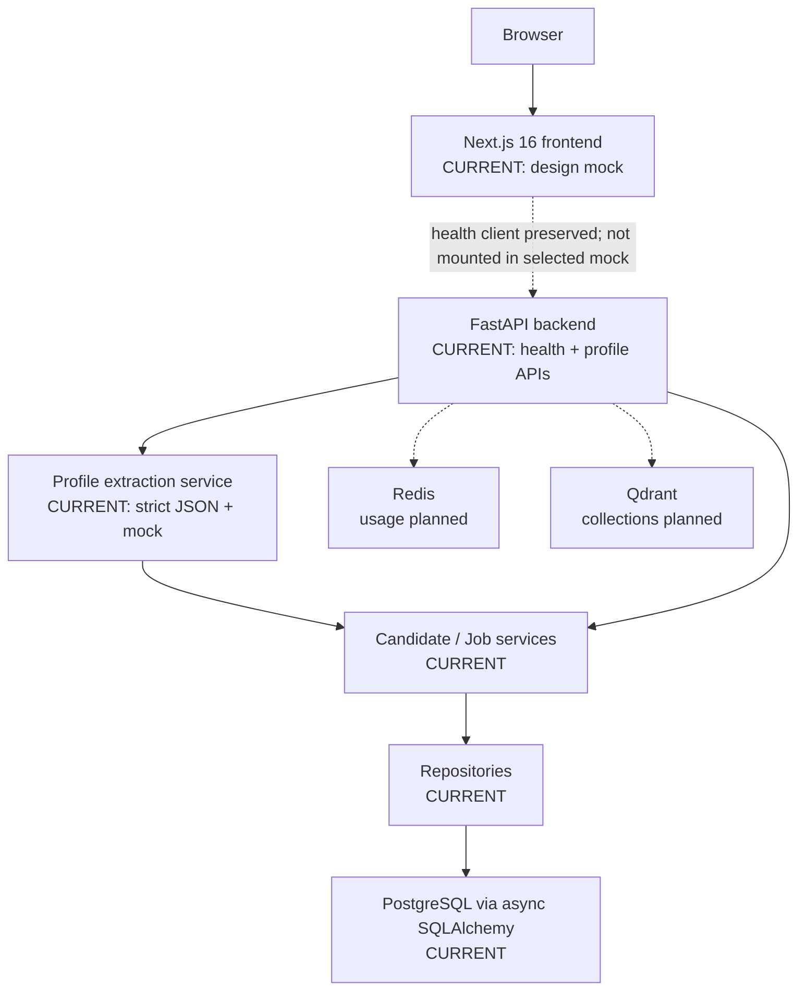
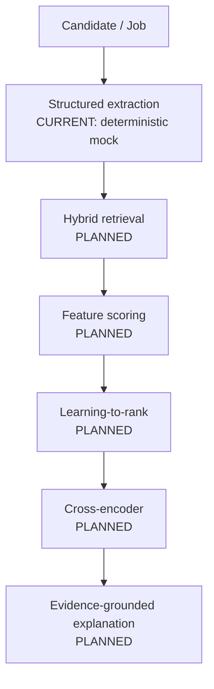

# PeopleMatch Agent Architecture

## System Context

PeopleMatch Agent is a local monorepo with these logical areas:

| Area | Responsibility | Current status |
|---|---|---|
| Frontend | Product UI and typed API consumption | **CURRENT:** Phase 0.5 Matching Results design mock; Phase 0 health client preserved but not mounted |
| Backend | HTTP boundary, application configuration, tracing, canonical data contracts | **CURRENT:** FastAPI liveness, candidate/job CRUD, and Phase 3 structured extraction |
| Storage | Durable candidate/job/match-run data | **CURRENT:** PostgreSQL candidate/job profiles with normalized evidence and requirements; match-run storage **PLANNED** |
| Retrieval | Candidate/job recall and vector search | Qdrant container config **CURRENT**; retrieval logic **PLANNED** |
| Ranking | Features, LTR, and reranking | **PLANNED** |
| AI Provider | Structured extraction and later grounded explanation | **CURRENT:** provider interface plus deterministic no-network mock; real LLM and explanation **PLANNED** |
| Cache / ephemeral state | Later caching and coordination | Redis container config **CURRENT**; business usage **PLANNED** |

## Current Phase Architecture

**CURRENT during Phase 3:** Next.js still serves the selected Matching Results design mock and does not consume profile APIs. FastAPI exposes liveness, typed candidate/job CRUD, and structured extraction preview/persistence endpoints. Extraction prompts treat source text as untrusted, the deterministic mock proposes strict JSON business fields, Pydantic reuses canonical nested/domain validation, and existing Candidate/Job services inject server-owned source, identity, and provenance before optional PostgreSQL persistence. Phase 1 JSONL remains frozen and is imported only after hash verification.

The liveness route still makes no downstream calls. Redis and Qdrant are healthy local infrastructure only; Phase 3 initializes no cache key, vector collection, retrieval algorithm, or real AI provider.

### Runtime Architecture

Solid arrows describe the current Phase 3 extraction and profile-persistence flow. Dotted arrows show configured infrastructure with no business integration.

## Target Architecture

**PLANNED:** Later phases add a real structured-output provider, match-run orchestration, hybrid retrieval, evidence-aware features, learned ranking, cross-encoder reranking, explanations, feedback, bad-case review, and offline evaluation metrics. Phase 2 persistence remains the stable domain foundation.

The target remains a modular monolith unless a measured need justifies a different deployment boundary. Phase 0 does not introduce microservices, Kubernetes, authentication, or distributed infrastructure.

### Future Matching Flow

## Request and Error Flow

1. A caller may supply `X-Request-ID`; otherwise middleware generates a UUID.
2. Middleware stores the ID on request state before routing.
3. The health route or error handler includes the same ID in the body.
4. Middleware writes the ID to the response header.
5. The preserved Phase 0 frontend health client treats non-2xx, invalid, or unreachable health responses as unavailable; it is not mounted in the Phase 0.5B mock screen.

Unknown routes, validation errors, and unexpected application exceptions use one typed envelope. Unexpected error details are logged locally but not returned to clients.

## Layer Responsibility

### API Layer

Owns HTTP routing, transport validation, response codes, response envelopes, and exception-to-HTTP mapping. It does not own ranking behavior.

### Service Layer

Owns candidate/job validation, server-generated identifiers, frozen-record protection, and atomic mutation boundaries. The extraction service owns prompt construction, provider resolution, strict decoding, bounded repair, fingerprints, and optional handoff to persistence. Retrieval, scoring, ranking, explanation, feedback, and evaluation services remain planned.

### Repository Layer

Owns candidate/job persistence operations and hides async SQLAlchemy mechanics from services. Candidate queries eagerly load skills, projects, and evidence with `selectinload`; job queries eagerly load requirements.

### Schema Layer

Owns API request/response contracts and canonical data transfer objects. Phase 2 extends the frozen Phase 1 profile semantics with typed create/PATCH records and persistence provenance while leaving label/evaluation contracts offline.

### Model Layer

Owns PostgreSQL SQLAlchemy models and metadata. Phase 2 normalizes candidate skills/projects/evidence and job requirements while using typed ARRAY/JSONB fields for bounded structured metadata.

### Infrastructure

Owns local Compose services, images, ports, volumes, and healthchecks. Infrastructure availability is not conflated with application liveness.

## Important Design Principles

### LLM does not own final ranking

The LLM is planned for semantic extraction, structured profile generation, and evidence-grounded explanation. Final ordering must come from deterministic constraints and/or a learned ranking pipeline with inspectable inputs. An explanation cannot change the rank it describes.

### Evidence-aware matching

A skill claim and project evidence are distinct data. Later scoring must preserve source references, evidence strength, gaps, and uncertainty rather than collapse them into one semantic score.

### Evaluation-first

Algorithm changes are not “improvements” until compared on a fixed, documented offline dataset. Evaluations must capture dataset, labels, split, configuration, code version, and limitations.

### Traceability

Request IDs begin transport tracing in Phase 0. Future match runs must record pipeline-stage inputs/outputs, model or rule versions, feature values, and explanation evidence so bad cases can be attributed.

### Honest failure

Unavailable dependencies and invalid responses must be visible. The system must not convert failures into empty data or fake success.

### Modular monolith first

Clear module boundaries matter before deployment boundaries. A local modular monolith keeps early phases understandable and testable without speculative distributed complexity.

## Configuration and Secrets

The backend reads environment-backed settings via Pydantic Settings. Compose interpolates the same variable names from root `.env`. `.env.example` contains local-only examples; `.env` is ignored. `EXTRACTION_PROVIDER=mock` is the only implemented Phase 3 provider; attempts are bounded to two and timeout is environment-backed. `LLM_API_KEY` remains optional and unused. Selecting an unimplemented provider fails explicitly rather than falling back to mock.

## Data Architecture Boundary

Phase 1 remains the immutable source of synthetic sandbox profiles and offline labels. Phase 2 imports only candidate and job profiles into PostgreSQL; relevance labels and pairwise preferences remain offline evaluation files. The importer validates the freeze manifest, preserves all canonical IDs, is idempotent for identical frozen records, and fails rather than overwriting conflicts. Redis is reserved for justified ephemeral use and Qdrant for future vector retrieval.
