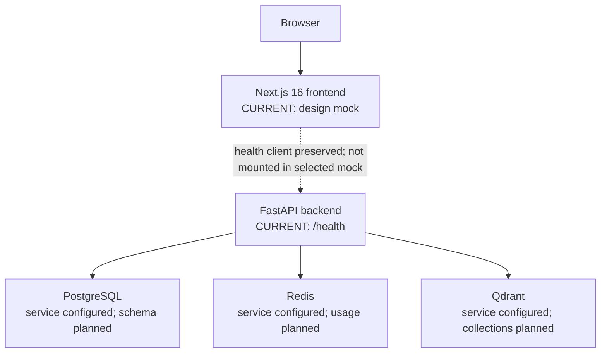
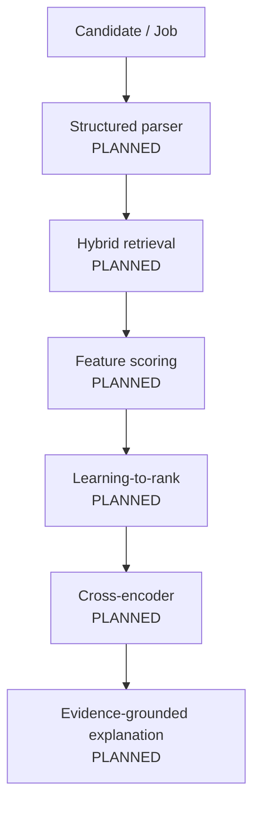

# PeopleMatch Agent Architecture

## System Context

PeopleMatch Agent is a local monorepo with these logical areas:

| Area | Responsibility | Current status |
|---|---|---|
| Frontend | Product UI and typed API consumption | **CURRENT:** Phase 0.5 Matching Results design mock; Phase 0 health client preserved but not mounted |
| Backend | HTTP boundary, application configuration, tracing, canonical data contracts | **CURRENT:** FastAPI liveness plus offline Phase 1 Pydantic contracts/validation; no domain API |
| Storage | Durable candidate/job/match-run data | **CURRENT:** validated JSONL sandbox data and PostgreSQL container config; database domain schema **PLANNED** |
| Retrieval | Candidate/job recall and vector search | Qdrant container config **CURRENT**; retrieval logic **PLANNED** |
| Ranking | Features, LTR, and reranking | **PLANNED** |
| AI Provider | Extraction and grounded explanation | Interface concept **PLANNED**; no provider or key required |
| Cache / ephemeral state | Later caching and coordination | Redis container config **CURRENT**; business usage **PLANNED** |

## Current Phase Architecture

**CURRENT during Phase 1:** Browser → Next.js still serves the selected Matching Results design mock. FastAPI `GET /health` remains the only business-facing endpoint. Separately, Phase 1 provides offline Pydantic contracts and validated JSONL for candidates, jobs, evidence, relevance labels, and pairwise preferences. These assets are consumed by developer scripts and tests, not by the UI or an API. Local Compose definitions and empty SQLAlchemy metadata remain unchanged.

The liveness route makes no downstream calls. No candidate/job table, vector collection, cache key, algorithm, or AI provider is initialized.

### Runtime Architecture

Solid arrows describe runtime connectivity available to the local environment. They do not imply Phase 1 performs database, cache, vector, or ranking operations.

## Target Architecture

**PLANNED:** Later phases add persistence repositories, structured extraction, match-run orchestration, hybrid retrieval, evidence-aware features, learned ranking, cross-encoder reranking, explanations, feedback, bad-case review, and offline evaluation metrics.

The target remains a modular monolith unless a measured need justifies a different deployment boundary. Phase 0 does not introduce microservices, Kubernetes, authentication, or distributed infrastructure.

### Future Matching Flow

## Request and Error Flow

1. A caller may supply `X-Request-ID`; otherwise middleware generates a UUID.
2. Middleware stores the ID on request state before routing.
3. The health route or error handler includes the same ID in the body.
4. Middleware writes the ID to the response header.
5. The preserved Phase 0 frontend health client treats non-2xx, invalid, or unreachable health responses as unavailable; it is not mounted in the Phase 0.5B mock screen.

Unknown routes, validation errors, and unexpected application exceptions use one typed envelope. Unexpected error details are logged locally but not returned to clients.

## Layer Responsibility

### API Layer

Owns HTTP routing, transport validation, response codes, response envelopes, and exception-to-HTTP mapping. It does not own ranking behavior.

### Service Layer

**PLANNED:** Owns application use cases and orchestration across profile parsing, retrieval, scoring, ranking, explanation, feedback, and evaluation. A service is added only when executable phase behavior exists.

### Repository Layer

**PLANNED:** Owns persistence operations and hides storage mechanics from services. Phase 0 has no repositories because it has no domain data.

### Schema Layer

Owns API request/response contracts and canonical data transfer objects. Phase 1 implements strict, versioned Pydantic v2 contracts for synthetic candidate profiles, job profiles, project evidence, relevance labels, and pairwise preferences. These are data contracts only; no persistence model or business API is implied.

### Model Layer

Owns SQLAlchemy persistence models and metadata. Phase 0 exposes empty metadata for Alembic and intentionally defines no domain table.

### Infrastructure

Owns local Compose services, images, ports, volumes, and healthchecks. Infrastructure availability is not conflated with application liveness.

## Important Design Principles

### LLM does not own final ranking

The LLM is planned for semantic extraction, structured profile generation, and evidence-grounded explanation. Final ordering must come from deterministic constraints and/or a learned ranking pipeline with inspectable inputs. An explanation cannot change the rank it describes.

### Evidence-aware matching

A skill claim and project evidence are distinct data. Later scoring must preserve source references, evidence strength, gaps, and uncertainty rather than collapse them into one semantic score.

### Evaluation-first

Algorithm changes are not “improvements” until compared on a fixed, documented offline dataset. Evaluations must capture dataset, labels, split, configuration, code version, and limitations.

### Traceability

Request IDs begin transport tracing in Phase 0. Future match runs must record pipeline-stage inputs/outputs, model or rule versions, feature values, and explanation evidence so bad cases can be attributed.

### Honest failure

Unavailable dependencies and invalid responses must be visible. The system must not convert failures into empty data or fake success.

### Modular monolith first

Clear module boundaries matter before deployment boundaries. A local modular monolith keeps early phases understandable and testable without speculative distributed complexity.

## Configuration and Secrets

The backend reads environment-backed settings via Pydantic Settings. Compose interpolates the same variable names from root `.env`. `.env.example` contains local-only examples; `.env` is ignored. `LLM_API_KEY` is optional and unused in Phase 0.

## Data Architecture Boundary

Phase 1 stores versioned synthetic sandbox records as validated JSONL and exports JSON Schema from the canonical Pydantic models. Its seed manifest contains deterministic hashes for future consumption but performs no database insertion. PostgreSQL remains the future system of record in Phase 2, Redis is reserved for justified ephemeral use, and Qdrant is reserved for vector retrieval. Alembic still loads empty metadata and no domain table exists.
