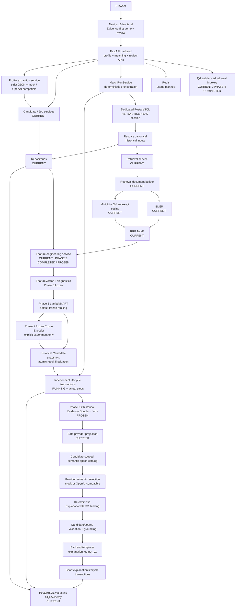
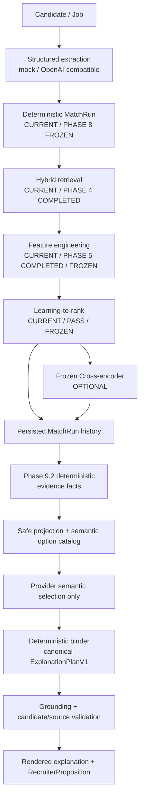

# PeopleMatch Agent Architecture

## System Context

PeopleMatch Agent is a local monorepo with these logical areas:

| Area | Responsibility | Current status |
|---|---|---|
| Frontend | Product UI and typed API consumption | **PHASE 15 COMPLETED / FROZEN:** JD-first workbench with read-only Provider status, bounded loading/error states, Candidate Lifecycle, history, and frozen review integration |
| Backend | HTTP boundary, application configuration, tracing, canonical data contracts | **CURRENT:** FastAPI profile/matching/explanation APIs plus frozen Phase 10 review services and typed API commands |
| Storage | Durable profile, historical execution, explanation, and review data | **CURRENT:** PostgreSQL profiles, immutable Phase 8/9 history, and append-only Phase 10 Feedback/BadCase audit |
| Retrieval | Candidate/job first-stage recall and vector search | **CURRENT / PHASE 4 COMPLETED:** versioned documents, local pretrained dense embeddings, Qdrant exact search, BM25, explicit filters, RRF, and offline retrieval evaluation |
| Feature Engineering | Versioned pair features and diagnostics | **CURRENT / PHASE 5 COMPLETED / FROZEN:** label-free on-demand extraction that preserves retrieval order |
| Ranking | LTR, final scoring, and reranking | **CURRENT / PHASE 6 FROZEN + PHASE 7 FROZEN:** deterministic LightGBM LambdaMART owns the default final order; the pinned Cross-Encoder remains an explicit optional experiment, not a default rerank or hiring score |
| AI Provider | Structured extraction and bounded semantic selection | **CURRENT / PHASE 9 OPTION B:** extraction and explanation adapters share OpenAI-compatible transport; explanation selects candidate-scoped options, while code binds canonical plan structure and Grounding checks sources. The provider never owns ranking or persisted facts |
| Evaluation | Stage-aware local offline evaluation | **PHASE 11 COMPLETED / FROZEN:** full-corpus retrieval, common-pool judged-condensed ranking, explicit pairwise evidence, sealed post-exposure Test evaluation, separate explanation/review/latency diagnostics, and immutable artifacts |
| Cache / ephemeral state | Later caching and coordination | Redis container config **CURRENT**; business usage **PLANNED** |

## Current Phase Architecture

**CURRENT / PHASE 15 COMPLETED / FROZEN:** Recommendation and ingestion remain separate product flows. A Job Description is the default recommendation Query and drives schema-first Job understanding → Candidate Retrieval → Feature Engineering → LambdaMART Top-K → Evidence-grounded Explanation. Resume Text belongs to talent-library management: the user previews a schema-validated Candidate Profile, explicitly confirms persistence, and then refreshes the derived Qdrant index. PostgreSQL remains profile truth; runtime candidates do not mutate the frozen 48-person dataset or Phase 11 artifacts.

Extraction and explanation remain separate domains but compose one shared OpenAI-compatible transport rather than adding parallel clients. Each task independently selects deterministic mock or `openai_compatible`, loads its own versioned Prompt asset, and records a non-secret configuration/prompt fingerprint. The read-only status projection describes configuration, not network connectivity. Missing configuration, timeout, rate limit, unavailable service, and invalid structured output fail explicitly without automatic mock fallback. The browser uses typed runtime-validated contracts and exposes raw LTR margin, Evidence refs, and immutable trace without inventing a probability or hiring score. The Phase 15 freeze had no local live credential; a later, separate synthetic Fresh Top-3 controlled run verified real-provider Extraction and Phase 9 semantic selection, not production operation.

The frozen file-backed `phase11_eval_protocol_v1` evaluator and selected artifacts are read-only Phase 12 evidence. The corrected formal run `20260831T173246Z_test_corrected_final` preserves Sparse and LTR as predeclared Dev leaders. Its five synthetic Test Jobs remain a post-exposure fixed sandbox evaluation, not pristine held-out or real-world generalization. See `docs/offline-evaluation.md`.

Next.js continues to preserve the selected Phase 0.5 Evidence-first shell while contextual MatchRun/Explanation reads supply opaque historical locators to structured Feedback forms. The browser never supplies Candidate/rank truth; the frozen service layer re-resolves persisted ownership. Bad Case queue/detail pages consume bounded privacy-safe projections and send only closed append-only review commands with expected revisions. PostgreSQL remains the source of immutable historical execution and review workflow truth.

The liveness route still makes no downstream calls and therefore does not load or download the embedding model. Redis remains infrastructure-only. Qdrant now stores derived Candidate/Job retrieval indexes; it is never the canonical profile source.

### Runtime Architecture

The MatchRun request first creates durable `RUNNING` history through an independent lifecycle transaction. One dedicated PostgreSQL `REPEATABLE READ` execution session then resolves canonical inputs and flows through the frozen Phase 4/5/6 graph plus the explicit optional Phase 7 service. Returned Candidate snapshots, results, `persist_results` completion, and terminal `COMPLETED` state are finalized atomically. PostgreSQL snapshot isolation stabilizes canonical profile reads for that execution; it does not transactionally freeze Qdrant. Qdrant remains derived external retrieval state whose freshness and configuration provenance are recorded. The dotted Redis arrow shows configured infrastructure with no business integration.

## Final Local Prototype Architecture

Phase 10 adds frozen bounded frontend Feedback and Bad Case review on top of the immutable historical and service boundaries. Phase 11's completed offline evaluator remains separate from APIs and runtime ranking and preserves incomplete-judgment, common-pool, Test-seal, provenance, immutability, and claim-boundary rules. Its Dev and post-exposure Test artifacts are descriptive synthetic evidence only. Current Phase 9 builds deterministic EvidenceFacts from durable historical context, lets the provider select candidate-scoped semantic options, and binds canonical ExplanationPlanV1 structure in code before Grounding and rendering. It does not make causal claims or alter ranking. Phase 6 remains the default ranking baseline and Phase 7 is an optional experimental pinned comparison, neither of which is a final match score.

The target remains a modular monolith unless a measured need justifies a different deployment boundary. Phase 0 does not introduce microservices, Kubernetes, authentication, or distributed infrastructure.

### Frozen Matching Flow

## Request and Error Flow

1. A caller may supply `X-Request-ID`; otherwise middleware generates a UUID.
2. Middleware stores the ID on request state before routing.
3. The health route or error handler includes the same ID in the body.
4. Middleware writes the ID to the response header.
5. The preserved Phase 0 frontend health client treats non-2xx, invalid, or unreachable health responses as unavailable; it is not mounted in the Phase 0.5B mock screen.

Unknown routes, validation errors, and unexpected application exceptions use one typed envelope. Unexpected error details are logged locally but not returned to clients.

## Layer Responsibility

### API Layer

Owns HTTP routing, transport validation, response codes, response envelopes, and exception-to-HTTP mapping. It does not own ranking behavior.

### Service Layer

Owns Candidate/Job validation, extraction, retrieval, frozen Phase 5/6/7 behavior, Phase 8 orchestration, and the additive Phase 9 explanation orchestration. MatchRunService remains unchanged. Explanation generation reads one completed historical aggregate, delegates pure evidence/grounding/rendering work outside transactions, and uses short independent repository transactions for RUNNING, evidence, attempt, and terminal transitions. Provider output never directly reaches persistence. Regeneration creates a new immutable history row.

### Repository Layer

Owns candidate/job persistence operations and hides async SQLAlchemy mechanics from services. Candidate queries eagerly load skills, projects, and evidence with `selectinload`; job queries eagerly load requirements.

### Schema Layer

Owns API request/response contracts and canonical data transfer objects. Phase 2 extends the frozen Phase 1 profile semantics with typed create/PATCH records and persistence provenance while leaving label/evaluation contracts offline.

### Model Layer

Owns PostgreSQL SQLAlchemy models and metadata. Phase 2 normalizes candidate skills/projects/evidence and job requirements while using typed ARRAY/JSONB fields for bounded structured metadata.

### Infrastructure

Owns local Compose services, images, ports, volumes, and healthchecks. Infrastructure availability is not conflated with application liveness.

## Important Design Principles

### LLM does not own final ranking

The LLM is planned for semantic extraction, structured profile generation, and evidence-grounded explanation. Final ordering must come from deterministic constraints and/or a learned ranking pipeline with inspectable inputs. An explanation cannot change the rank it describes.

### Evidence-aware matching

A skill claim and project evidence are distinct data. Later scoring must preserve source references, evidence strength, gaps, and uncertainty rather than collapse them into one semantic score.

### Evaluation-first

Algorithm changes are not “improvements” until compared on a fixed, documented offline dataset. Evaluations must capture dataset, labels, split, configuration, code version, and limitations.

### Traceability

Request IDs begin transport tracing in Phase 0. Future match runs must record pipeline-stage inputs/outputs, model or rule versions, feature values, and explanation evidence so bad cases can be attributed.

### Honest failure

Unavailable dependencies and invalid responses must be visible. The system must not convert failures into empty data or fake success.

### Modular monolith first

Clear module boundaries matter before deployment boundaries. A local modular monolith keeps early phases understandable and testable without speculative distributed complexity.

## Configuration and Secrets

The backend reads environment-backed settings via Pydantic Settings. Compose interpolates the same variable names from root `.env`; `.env.example` contains placeholders and `.env` is ignored. `EXTRACTION_PROVIDER` and `EXPLANATION_PROVIDER` independently select `mock` or `openai_compatible`, while `LLM_BASE_URL`, `LLM_MODEL`, and `LLM_API_KEY` configure the shared transport. The `deepseek` selector and `EXPLANATION_DEEPSEEK_*` variables remain compatibility aliases only. Base URLs must be credential-free HTTPS URLs; API keys are excluded from repr, status responses, prompt provenance, fingerprints, logs, and client errors. Selecting an unsupported or incomplete provider fails explicitly rather than falling back to mock.

## Data Architecture Boundary

Phase 1 remains the immutable source of synthetic sandbox profiles and offline labels. Phase 2 imports only Candidate and Job profiles into PostgreSQL; relevance labels and pairwise preferences remain offline evaluation files. PostgreSQL is the canonical runtime profile state. Qdrant is a derived frozen Phase 4 vector index rebuilt explicitly from PostgreSQL and guarded by ID/version/fingerprint freshness checks; loss of Qdrant does not lose canonical data. Runtime retrieval, feature extraction, and ranking never read labels or splits. Phase 6 offline builders consume only explicit Train/Dev judgments; its runtime loader consumes only the validated native model and Phase 5 vectors. Redis remains reserved for justified future ephemeral use.
