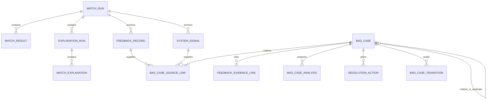

# Phase 10A Bad Case System Design

## Document Status

- **Phase:** 10A — Architecture Review
- **Status:** Proposed; waiting for Phase 10B implementation approval
- **Baseline:** `6d363574b10627fd232e499fc38b5461899c85fd`
- **Scope:** BadCase definition, taxonomy, entities, review workflow, root-cause analysis, and resolution design
- **No implementation:** this document creates no table, migration, endpoint, UI, metric, benchmark, or automated remediation

## Bad Case Definition

A BadCase is an auditable review aggregate for one observed mismatch or integrity problem anchored to an immutable historical MatchRun. It connects an observation to supporting historical evidence, a reviewed root-cause hypothesis, and tracked resolution actions.

A BadCase is not:

- a generic application log;
- a mutable copy of MatchRun or Explanation data;
- proof that a model or Candidate is wrong;
- a ranking label or training row;
- an evaluation result;
- a profile correction;
- a free-form ticket with no historical owner.

## Design Principles

### Separate symptom from root cause

The source feedback describes what appears wrong. `BadCaseAnalysis` separately records where the reviewer believes the problem originated. For example, `wrong_top1` is an observed ranking symptom; `skill_fit_mismeasured` is a possible feature-layer root cause. The system must not infer the second from the first.

### Preserve historical ownership

Every v1 BadCase has exactly one primary MatchRun. Candidate/result/explanation references must resolve inside that history. Cross-run patterns remain separate cases linked by `related_case_id`; Phase 11 may later aggregate them.

### Append analysis, do not rewrite it

New evidence creates a new analysis revision. A rejected hypothesis remains visible. Resolution actions may supersede earlier actions but do not delete them.

### Keep taxonomy actionable

Every root-cause code maps to one affected layer and one allowed action class. Taxonomy is versioned in code/contracts rather than created as arbitrary database labels.

## Taxonomy Model

The taxonomy has three independent dimensions:

1. **Observed symptom** — what the reviewer saw.
2. **Root-cause layer and code** — what reviewed evidence supports.
3. **Resolution action class** — what kind of change should be considered.

Keeping these dimensions separate prevents a complaint from becoming an unsupported causal diagnosis.

## Observed Symptom Taxonomy

| Family | Codes | Meaning |
|---|---|---|
| Ranking | `wrong_top1`, `ranking_inversion`, `false_positive`, `false_negative`, `constraint_conflict`, `uncertain_order` | The recorded shortlist or pairwise order appears inappropriate |
| Retrieval | `expected_candidate_not_recalled`, `irrelevant_candidate_recalled`, `filter_exclusion_disagreement`, `pool_truncation_concern` | The recalled pool appears incomplete or noisy |
| Evidence | `missing_support`, `incorrect_support_status`, `project_skill_link_disagreement`, `requirement_coverage_disagreement` | Structured evidence appears absent, overstated, or misbound |
| Explanation | `unsupported_explanation`, `misleading_explanation`, `incomplete_explanation`, `incorrect_gap_statement`, `incorrect_top1_comparison` | Persisted explanation output appears unfaithful or incomplete |
| Data quality | `candidate_snapshot_issue`, `job_snapshot_issue`, `requirement_issue`, `constraint_issue` | A historical structured input appears wrong or unclear |
| Integrity / operations | `history_integrity_failure`, `ownership_failure`, `lifecycle_failure`, `provider_attempt_failure` | A deterministic contract or persistence boundary failed |

`false_negative` in Phase 10 means a human-reported expected result, not a measured Recall error. A Candidate absent from the historical result set cannot be described as a confirmed retrieval miss unless the reporter supplies a bounded expected Candidate identifier and the case remains `suspected` until reviewed. Current Candidate state is not silently loaded to backfill history.

## Root-Cause Taxonomy

### Ranking Error

| Code | Reviewed condition | Future action class |
|---|---|---|
| `ranking_wrong_top1` | Persisted top 1 conflicts with reviewed evidence/preferences | `ranking_change_hypothesis` |
| `ranking_pairwise_inversion` | Two results appear ordered incorrectly | `ranking_change_hypothesis` |
| `ranking_false_positive` | A returned high-ranked Candidate is judged unsuitable | `ranking_change_hypothesis` or `constraint_policy_hypothesis` |
| `ranking_false_negative` | A reviewed Candidate is materially under-ranked | `ranking_change_hypothesis` |
| `ranking_tie_break_issue` | Stable tie-break behavior is inappropriate for the case | `ranking_contract_hypothesis` |
| `ranking_constraint_policy_issue` | Location/seniority/other recorded constraints are applied inappropriately | `constraint_policy_hypothesis` |

Ranking feedback remains a human judgment. These codes do not become training labels automatically.

### Retrieval Error

| Code | Reviewed condition | Future action class |
|---|---|---|
| `retrieval_recall_miss` | Expected Candidate was not recalled under the recorded strategy | `retrieval_change_hypothesis` |
| `retrieval_filter_exclusion` | Explicit filter removed a Candidate unexpectedly | `filter_policy_hypothesis` |
| `retrieval_dense_coverage_gap` | Persisted dense channel evidence indicates a semantic coverage gap | `retrieval_change_hypothesis` |
| `retrieval_sparse_coverage_gap` | Persisted sparse channel evidence indicates a lexical coverage gap | `retrieval_change_hypothesis` |
| `retrieval_fusion_issue` | Recorded channel ranks and fusion appear to produce an undesirable pool | `fusion_policy_hypothesis` |
| `retrieval_pool_truncation` | Candidate was lost at a recorded pool boundary | `pool_policy_hypothesis` |
| `retrieval_index_integrity` | Recorded index freshness/version contract is inconsistent | `data_integrity_action` |

The analysis must cite historical retrieval context. It must not rerun retrieval and treat the new result as the old run's truth.

### Feature Error

| Code | Reviewed condition | Future action class |
|---|---|---|
| `feature_semantic_score_issue` | Recorded semantic feature meaning/value appears inappropriate | `feature_rule_hypothesis` |
| `feature_sparse_score_issue` | Recorded sparse feature appears inappropriate | `feature_rule_hypothesis` |
| `feature_skill_fit_issue` | Skill fit conflicts with structured skill/requirement evidence | `feature_rule_hypothesis` |
| `feature_project_evidence_issue` | Project evidence score conflicts with support status | `feature_rule_hypothesis` |
| `feature_role_direction_issue` | Role-direction relation is represented incorrectly | `feature_rule_hypothesis` |
| `feature_location_issue` | Location relation is represented incorrectly | `feature_rule_hypothesis` |
| `feature_seniority_issue` | Seniority relation is represented incorrectly | `feature_rule_hypothesis` |
| `feature_missing_penalty_issue` | Missing-requirement penalty is inconsistent with diagnostics | `feature_rule_hypothesis` |
| `feature_overclaim_penalty_issue` | Overclaim penalty is inconsistent with evidence support | `feature_rule_hypothesis` |
| `feature_availability_issue` | Feature is incorrectly available/unavailable | `feature_contract_hypothesis` |

Feature values are recorded ranking context, not capability proof. Root-cause analysis must cite the supporting snapshot/diagnostic evidence rather than infer ability from a score.

### Evidence Error

| Code | Reviewed condition | Future action class |
|---|---|---|
| `evidence_missing_project_support` | Relevant historical project support is absent | `data_correction_proposal` |
| `evidence_status_incorrect` | `available`, `claim_only`, `partial`, or absent status is disputed | `evidence_rule_hypothesis` |
| `evidence_skill_project_link_incorrect` | Skill/project ownership or relationship is wrong | `data_correction_proposal` or `evidence_rule_hypothesis` |
| `evidence_requirement_alignment_incorrect` | Candidate evidence is bound to the wrong requirement | `evidence_rule_hypothesis` |
| `evidence_claim_promoted_without_support` | A claim is treated as demonstrated without support | `evidence_integrity_action` |
| `evidence_owner_mismatch` | Evidence crosses Candidate, rank, project, Job, or bundle ownership | `integrity_repair_action` |

### Explanation Error

| Code | Reviewed condition | Future action class |
|---|---|---|
| `explanation_unsupported_claim` | Persisted text is not supported by cited deterministic evidence | `grounding_integrity_action` |
| `explanation_misleading_template` | Grounded facts are rendered in a materially misleading way | `template_change_hypothesis` |
| `explanation_incomplete_selection` | Important deterministic fact category is omitted | `planning_policy_hypothesis` |
| `explanation_incorrect_gap` | Missing/partial requirement statement contradicts facts | `grounding_integrity_action` |
| `explanation_comparison_mismatch` | Top-1 comparison conflicts with persisted rank-1 evidence | `grounding_integrity_action` |
| `explanation_reference_ownership` | Output reference crosses Candidate/rank/kind ownership | `integrity_repair_action` |
| `explanation_clarity_issue` | Text is grounded but unclear | `template_change_hypothesis` |

Explanation review always anchors to the persisted ExplanationRun and Candidate output. A new explanation never replaces the reviewed one.

### Data Quality Error

| Code | Reviewed condition | Future action class |
|---|---|---|
| `data_candidate_skill_missing` | Historical Candidate snapshot omits a relevant structured skill | `data_correction_proposal` |
| `data_candidate_skill_incorrect` | Historical Candidate snapshot contains an incorrect skill | `data_correction_proposal` |
| `data_project_evidence_missing` | Historical snapshot lacks relevant project evidence | `data_correction_proposal` |
| `data_candidate_seniority_incorrect` | Historical Candidate seniority is disputed | `data_correction_proposal` |
| `data_candidate_location_incorrect` | Historical Candidate location/preferences are disputed | `data_correction_proposal` |
| `data_job_requirement_unclear` | Requirement is ambiguous | `data_correction_proposal` |
| `data_job_requirement_missing` | Historical Job snapshot lacks a requirement | `data_correction_proposal` |
| `data_job_requirement_priority_incorrect` | Must-have/nice-to-have classification is disputed | `data_correction_proposal` |
| `data_job_level_incorrect` | Job seniority requirement is disputed | `data_correction_proposal` |
| `data_job_expectation_missing` | Structured Job expectations are incomplete | `data_correction_proposal` |

Data feedback never patches the historical snapshot. A separately authorized profile correction affects only future MatchRuns.

### Integrity / Operational Error

| Code | Reviewed condition | Future action class |
|---|---|---|
| `integrity_snapshot_fingerprint` | Historical content no longer matches its stored fingerprint | `integrity_repair_action` |
| `integrity_result_fingerprint` | Persisted result payload conflicts with its fingerprint | `integrity_repair_action` |
| `integrity_cross_owner_reference` | Source ownership validation fails | `integrity_repair_action` |
| `integrity_terminal_overwrite` | Terminal history was subject to an invalid mutation attempt | `integrity_repair_action` |
| `integrity_attempt_audit` | Explanation attempt and parent lifecycle disagree | `integrity_repair_action` |

Integrity cases may be system-created because the condition is deterministic. They still require review before a code-level root cause is marked confirmed.

## Severity

Severity measures decision-system impact, not Candidate quality.

| Severity | Definition |
|---|---|
| `LOW` | Clarity or completeness concern with no identified decision effect |
| `MEDIUM` | Localized evidence, feature, or ordering concern requiring review |
| `HIGH` | Material top-rank, must-have, false-positive/negative, or repeated workflow issue |
| `CRITICAL` | Historical integrity, privacy, cross-owner leakage, secret exposure, or systemic terminal-state corruption |

Automatic signals may assign an initial severity only for deterministic integrity classes. Human/model-quality issues require reviewer confirmation.

## Entity Proposal

### FeedbackRecord

Immutable reviewer observation.

| Field | Rule |
|---|---|
| `feedback_id` | Server-owned durable ID |
| `contract_version` | Immutable feedback contract version |
| `feedback_type` | `ranking`, `explanation`, or `data_profile` |
| `origin` | `human`; system observations use `SystemSignal` |
| `match_run_id` | Required immutable historical owner |
| `payload` | Discriminated typed payload; no arbitrary dict |
| `note_safe` | Optional bounded human note; not a factual source |
| `supersedes_feedback_id` | Optional same-owner correction link |
| `created_at` | Server timestamp |

### SystemSignal

Immutable deterministic observation.

Fields include `signal_id`, `signal_contract_version`, `match_run_id`, optional `explanation_run_id`, closed `signal_code`, bounded source stage, source error code, source occurrence identity, and `created_at`. It stores no stack trace, prompt, provider response, raw snapshot, or secret.

### BadCase

The mutable workflow root with immutable historical identity.

| Field | Source / mutability |
|---|---|
| `bad_case_id` | Server-owned and immutable |
| `case_contract_version` | Immutable |
| `taxonomy_version` | Immutable for the case; explicit migration/reclassification creates an analysis revision |
| `primary_match_run_id` | Required immutable historical FK |
| `primary_match_result_id` | Optional immutable result FK; required for result-level cases |
| `historical_job_id` | Derived from MatchRun; immutable if denormalized |
| `historical_candidate_id` / `result_rank` | Derived from MatchResult; immutable if denormalized |
| `primary_explanation_run_id` | Optional immutable FK |
| `primary_match_explanation_id` | Optional immutable Candidate explanation FK |
| `symptom_family` / `symptom_code` | Closed initial classification; corrections use analysis/transition history |
| `severity` | Mutable only through an audited transition |
| `status` | Mutable only through lifecycle service |
| `duplicate_of_bad_case_id` | Required only for `DUPLICATE` |
| `revision` | Monotonic optimistic-concurrency value |
| `created_at` / `updated_at` | Server timestamps |

The API may expose `job_id`, `candidate_id`, and `rank`, but the repository owns their derivation. A caller cannot bind a Case to a Candidate that is not the selected MatchResult owner.

### BadCaseSourceLink

Append-only link from a BadCase to one FeedbackRecord or SystemSignal. Exactly one source variant is populated. It prevents mutation of an immutable feedback record when triage later attaches it to a case.

### FeedbackEvidenceLink

Append-only link containing the owning historical artifact, internal evidence ID or closed snapshot field locator, link purpose (`supports_observation`, `disputed_reference`, or `missing_expected_evidence`), evidence kind, and Candidate/rank owner where applicable.

Evidence IDs are scoped by their owning ExplanationRun/Evidence Bundle; an ID string alone is not globally meaningful. Missing expected evidence uses a closed field locator and reviewer note, not a fabricated Evidence ID.

### BadCaseAnalysis

Append-only root-cause revision.

| Field | Rule |
|---|---|
| `analysis_id`, `bad_case_id`, `revision_number` | Server-owned; unique and monotonic per case |
| `assessment` | `suspected`, `supported`, `confirmed`, or `rejected` |
| `root_cause_layer` | Closed pipeline/data/explanation/integrity layer |
| `root_cause_code` | Must belong to layer under `taxonomy_version` |
| `analysis_summary_safe` | Bounded human analysis; not provider input or model fact |
| `supporting_reference_ids` | Validated historical links, stored through link rows |
| `created_at` | Server timestamp |

`confirmed` requires at least one compatible historical reference and may not rely only on free text. A new revision supersedes, rather than overwrites, an older hypothesis.

### ResolutionAction

Append-only or explicitly superseded improvement action.

Fields include `action_id`, `bad_case_id`, closed `action_class`, bounded hypothesis, affected component/contract, status, optional safe change reference, completion timestamp, supersession link, and server timestamps. It cannot contain an executable patch, credentials, prompt, raw Candidate data, or an evaluation metric.

### BadCaseTransition

Append-only lifecycle audit containing `bad_case_id`, `from_status`, `to_status`, reason code, optional related analysis/action, previous/new revision, and server timestamp. Phase 10 has no authenticated actor, so it records `origin=manual_review` or `origin=system_rule` without claiming user identity.

### FeedbackLabel / taxonomy registry

Phase 10B should not begin with a mutable `FeedbackLabel` table. Closed enums and a checked-in `feedback_taxonomy_v1` contract provide reproducibility and prevent uncontrolled labels. A database taxonomy registry is justified only if later governance requires runtime-managed vocabularies; it remains out of Phase 10B v1.

## Entity Relationships



## Ownership and Immutability Matrix

| Data | Historical source | Caller may supply | Mutable after creation |
|---|---|---|---|
| MatchRun identity/Job/variant | Frozen MatchRun | Only durable run ID | No |
| Candidate identity/rank | Frozen MatchResult | Result selector; server resolves fields | No |
| Explanation identity | Frozen ExplanationRun/MatchExplanation | Durable IDs | No |
| Evidence reference | Persisted Evidence Bundle | Existing ID only; server validates owner/kind | No |
| Snapshot field locator | Frozen input snapshot | Closed locator only | No |
| Feedback verdict/reason | Human reviewer | Closed enum values | No; supersede with new FeedbackRecord |
| BadCase status/severity | Review workflow | Requested transition | Yes, only through audited transition |
| Root-cause analysis | Human reviewer/system integrity review | Closed cause plus bounded note | No; append revision |
| Resolution action | Human reviewer | Closed action plus bounded hypothesis | Status/supersession through audited operation |

## BadCase Lifecycle

### Main path

```text
CREATED
  ↓
REVIEWED
  ↓
ROOT_CAUSE_IDENTIFIED
  ↓
ACTION_PLANNED
  ↓
RESOLVED
  ↓
VERIFIED
```

| Status | Entry requirement | Meaning |
|---|---|---|
| `CREATED` | Historical owner and at least one source link validated | Case exists but has not been triaged |
| `REVIEWED` | Source bindings, severity, symptom, and duplicate status reviewed | Observation is understood; no root cause is implied |
| `ROOT_CAUSE_IDENTIFIED` | Latest analysis is `supported` or `confirmed` with compatible references | One review hypothesis is evidence-backed |
| `ACTION_PLANNED` | At least one active ResolutionAction exists | A bounded improvement action is proposed |
| `RESOLVED` | Required actions are completed or explicitly cancelled with disposition | Work is complete, but effectiveness is not established |
| `VERIFIED` | A reviewer links a new immutable artifact demonstrating the original symptom is addressed | Case-specific verification passed; no aggregate metric claim |

### Alternate dispositions

- `DISMISSED` — review found no actionable defect or insufficient support; requires disposition reason.
- `DUPLICATE` — links to one canonical BadCase with the same historical symptom.
- `REOPENED` is represented by a transition from `RESOLVED` or `VERIFIED` back to `REVIEWED`, preserving all prior audit history.

Invalid skips fail closed. For example, `CREATED → ACTION_PLANNED` is rejected because there is no reviewed analysis. `RESOLVED → VERIFIED` requires a verification link, not only a note.

## Root-Cause Analysis Workflow

1. Reconstruct context exclusively from the primary historical MatchRun and optional ExplanationRun.
2. Validate all source links, Candidate/rank owners, Evidence IDs, and snapshot field locators.
3. Record the observed symptom without assigning causality.
4. Form one or more analysis revisions with `suspected` status.
5. Cite compatible persisted facts or deterministic integrity events.
6. Promote one analysis to `supported` or `confirmed`, or mark it `rejected`.
7. Choose an action class compatible with the confirmed/supported root-cause layer.

Multiple causes are allowed through multiple analysis revisions or a primary/secondary cause relationship. The BadCase should expose one current primary analysis for workflow, while retaining all alternatives. Contradictory active `confirmed` analyses require explicit supersession or a multi-cause designation; they cannot silently coexist as one cause.

## Resolution Workflow

Resolution actions describe what should change, not how the system executes it.

Allowed action classes include:

- `data_correction_proposal`;
- `retrieval_change_hypothesis`;
- `filter_policy_hypothesis`;
- `feature_rule_hypothesis`;
- `feature_contract_hypothesis`;
- `ranking_change_hypothesis`;
- `ranking_contract_hypothesis`;
- `evidence_rule_hypothesis`;
- `planning_policy_hypothesis`;
- `template_change_hypothesis`;
- `grounding_integrity_action`;
- `integrity_repair_action`;
- `documentation_action`;
- `no_change`.

Phase 10 does not apply these changes. If later work produces a new profile revision, configuration, code commit, MatchRun, or ExplanationRun, the action may link that immutable reference. Verification compares only the original symptom against the new artifact and must state limitations.

## Automatic Discovery Boundary

### May create a system signal or integrity BadCase automatically

- fingerprint mismatch;
- ownership/namespace violation;
- failed terminal lifecycle invariant;
- persisted grounding failure category;
- repeated exact typed operational failure under an approved deterministic grouping key.

### Requires human feedback/review

- wrong ranking or top 1;
- false positive/false negative suitability;
- incomplete skill/project evidence;
- unclear requirements;
- misleading but structurally grounded explanation;
- candidate/job data correctness.

No automated source may infer personality, communication, leadership, culture fit, hiring probability, candidate truthfulness, or employment validity.

## Review Page Information Architecture

This is future IA only; the frontend remains unchanged.

The Bad Case Review page should follow:

```text
Immutable context
  → Observed mismatch
  → Source feedback/signals
  → Evidence and ownership
  → Root-cause analysis
  → Resolution actions
  → Verification state
```

Above the fold:

- severity, status, symptom code, and `Not yet validated` state;
- compact Job, Candidate, rank, strategy, MatchRun, and optional ExplanationRun context;
- original observation and source type;
- current primary analysis and affected stage.

Progressive detail:

- cited evidence and disputed references;
- prior analysis revisions;
- transition history;
- related/duplicate cases;
- resolution actions and safe change references.

The page must not show a universal Candidate score, modify source history, imply that a proposed fix succeeded, or mix Phase 11 evaluation metrics into the review workflow.

## Future Phase 10B Module Boundaries

Proposed modules, not created in Phase 10A:

```text
backend/app/schemas/feedback.py
backend/app/schemas/bad_cases.py
backend/app/models/feedback.py
backend/app/models/bad_case.py
backend/app/repositories/feedback_repository.py
backend/app/repositories/bad_case_repository.py
backend/app/services/feedback/contracts.py
backend/app/services/feedback/service.py
backend/app/services/bad_cases/taxonomy.py
backend/app/services/bad_cases/service.py
backend/app/api/routes/feedback.py
backend/app/api/routes/bad_cases.py
backend/tests/test_feedback_*.py
backend/tests/test_bad_case_*.py
data/contracts/feedback_record_v1.json
data/contracts/bad_case_v1.json
```

The exact file plan and migration number must be approved in Phase 10B. No existing Phase 4–9.4 contract should be changed to accommodate feedback.

## Proposed Future API Shape

These are design candidates, not implemented endpoints:

- `POST /api/v1/feedback` — create one typed immutable feedback record;
- `GET /api/v1/feedback/{feedback_id}` — inspect source binding and disposition links;
- `POST /api/v1/bad-cases` — create a case from validated feedback/signal sources;
- `GET /api/v1/bad-cases` — bounded filtering by status, severity, symptom, stage, and historical IDs;
- `GET /api/v1/bad-cases/{bad_case_id}` — read full review aggregate;
- `POST /api/v1/bad-cases/{bad_case_id}/analyses` — append an analysis revision;
- `POST /api/v1/bad-cases/{bad_case_id}/actions` — append a resolution action;
- `POST /api/v1/bad-cases/{bad_case_id}/transitions` — execute one validated lifecycle transition.

Requests cannot select arbitrary taxonomy strings, patch historical objects, attach raw documents, or submit evaluation metrics. API design remains subject to Phase 10B approval and TDD.

## Phase 11 Boundary

Phase 10 may provide exportable, versioned review records and safe case slices. Phase 11 decides whether and how reviewed feedback becomes an offline dataset, implements metrics, compares strategies, and reports limitations.

Phase 10 must not:

- compute accuracy, Recall, NDCG, MRR, agreement, trend, or uplift;
- call a benchmark runner;
- select a winning strategy;
- interpret case counts as quality rates;
- describe a completed ResolutionAction as measured improvement.

## Privacy and Audit Requirements

- No raw resume, raw JD, private employer data, contact details, URLs, credentials, prompts, provider responses, or stack traces.
- No arbitrary JSON metadata or unbounded human text.
- Notes and summaries are bounded, treated as sensitive review content, and excluded from providers/fingerprints unless a future contract explicitly says otherwise.
- Internal Evidence IDs remain scoped by owning historical bundle and are never accepted without ownership validation.
- Source tables use restrictive deletion semantics.
- Every lifecycle mutation appends an audit transition and checks the expected revision.
- No authentication identity is claimed in Phase 10; actor fields remain origin categories only.

## Phase 10B Readiness Questions

Implementation approval should confirm:

1. Phase 10B v1 requires a MatchRun anchor for every feedback record.
2. One issue per FeedbackRecord is the accepted request granularity.
3. Taxonomy is code/contract versioned rather than stored as mutable labels.
4. Human notes remain optional and bounded rather than required analysis prose.
5. `VERIFIED` is case-specific manual verification, while aggregate effectiveness remains Phase 11.
6. The proposed relational aggregate and append-only analysis/action/transition model is accepted.
