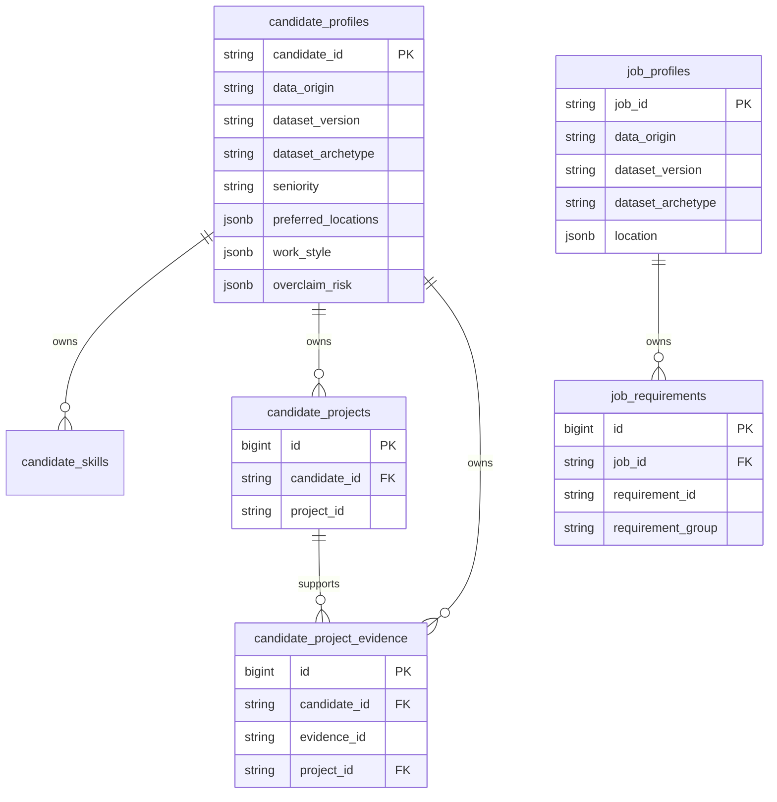

# Phase 2 Database Schema

## Scope

PostgreSQL is the durable profile store in Phase 2. The schema persists Phase 1 candidate and job contracts without storing relevance labels, pairwise preferences, embeddings, retrieval output, ranking scores, explanations, or evaluation metrics.

## Tables and Relationships

`candidate_skills`, `candidate_projects`, and `candidate_project_evidence` are normalized because their identity, ordering, relationship integrity, and cascade behavior matter. Projects, evidence, and job requirements use internal `BIGINT` surrogate primary keys that remain persistence-only and never enter canonical or API models. Canonical nested identifiers are owner-scoped through `UNIQUE(candidate_id, project_id)`, `UNIQUE(candidate_id, evidence_id)`, and `UNIQUE(job_id, requirement_id)`. Evidence also has a composite `(candidate_id, project_id)` foreign key, so it cannot point to another candidate's project. `job_requirements` records whether each canonical requirement belongs to `must_have` or `nice_to_have`.

## ARRAY and JSONB Decisions

PostgreSQL ARRAY is used for bounded string collections that are returned together and queried only by membership in Phase 2: target roles, AI tools, missing fields, project technologies/outcomes/demonstrated skills, evidence-supported skills, role directions, team tags, required seniorities, and evaluation focus.

JSONB is used for typed nested metadata whose internal shape is enforced by Pydantic but does not justify more tables at current query scope: candidate location preference, work style, overclaim risk, and job location. JSONB is not accepted as arbitrary API input; full Pydantic domain validation runs before writes.

## Provenance and Frozen Records

Imported records retain `data_origin=synthetic_sandbox`, canonical IDs, schema version `1.0`, dataset version `1.0.0`, and dataset-only archetype metadata. API-created records use `data_origin=user_created` and a null dataset version. The service layer rejects PATCH and DELETE for records with a dataset version using HTTP 409.

GitHub references are validated by provenance. `synthetic_sandbox` records accept only `sandbox://` or `example.invalid` references. `user_created` and future `llm_parsed` records accept `None` or a valid HTTP(S) URL. Mutation inputs cannot set origin, dataset version, or archetype.

`dataset_archetype` exists only for fixture provenance and analysis. It must not be used as retrieval text, embedding input, or ranking/model metadata in later phases.

## Transactions and Cascades

The request/session dependency owns the outer transaction. A service use case adds a savepoint around create or update so a nested uniqueness failure can be converted to a typed 409 without leaving partial rows. Creating a profile and all nested records is atomic. Candidate deletion cascades through skills, projects, and evidence; job deletion cascades through requirements. The database and ORM both declare the ownership relationship. Every successful scalar or nested PATCH explicitly advances the parent profile's `updated_at`.

## Loading and Indexes

Candidate detail and list queries use `selectinload` for skills, projects, and evidence. Job queries use `selectinload` for requirements. This provides bounded eager loading without multiplying parent rows and avoids per-row N+1 queries.

Indexes are limited to current structured access paths: candidate seniority and origin, plus job role title and origin. Parent canonical IDs remain primary keys; nested canonical IDs use owner-scoped uniqueness constraints and persistence-only surrogate row identities. No speculative ranking or vector indexes exist.

## Migration

Alembic revision `20260813_0001` creates and downgrades the six profile-domain tables. Compose runs `alembic upgrade head` before starting Uvicorn so a fresh local database reaches the expected schema. Database insertion of candidates and jobs remains an explicit seed command because hash verification must precede import.
