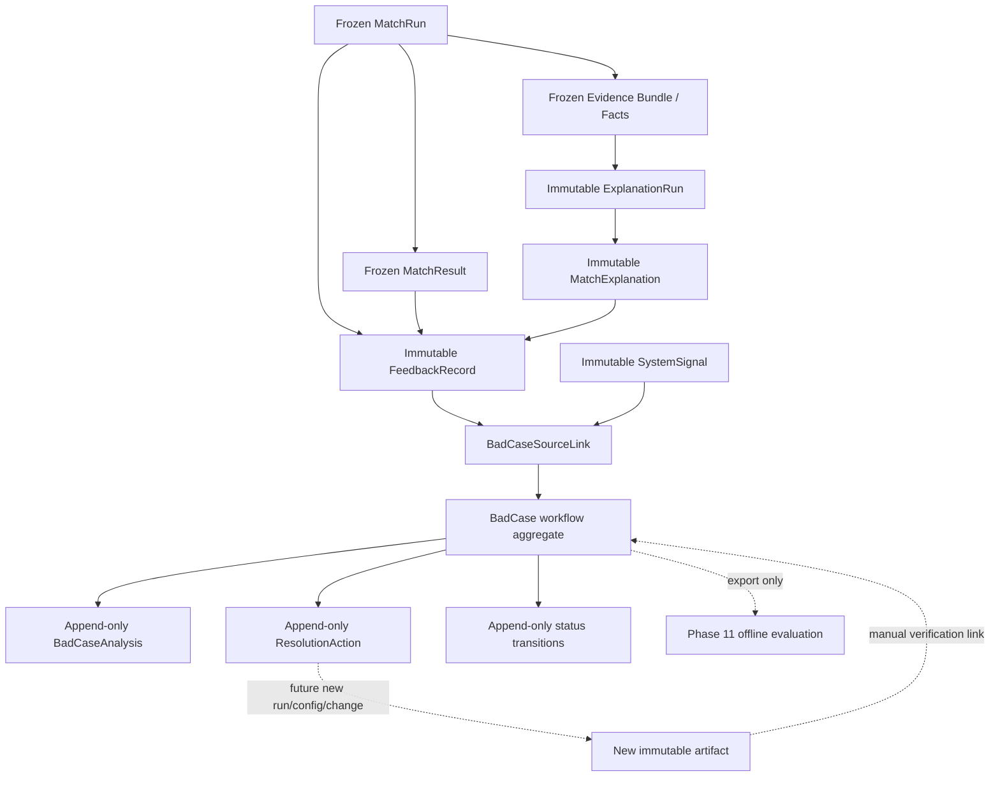

# Phase 10A Feedback Loop Architecture

## Document Status

- **Phase:** 10A — Architecture Review
- **Status:** Proposed; waiting for Phase 10B implementation approval
- **Baseline:** `6d363574b10627fd232e499fc38b5461899c85fd`
- **Scope:** Feedback collection, historical binding, review lifecycle, and improvement tracking design only
- **Not implemented here:** database models, migrations, APIs, frontend, authentication, evaluation, retraining, or model changes

## Goals

The feedback loop turns a reviewer's observation about a historical match into an auditable improvement hypothesis without changing the decision that was originally made.

The design must answer four questions:

1. What historical MatchRun, result, explanation, or snapshot was reviewed?
2. What did a human reviewer or deterministic system signal observe?
3. Is the observation a confirmed defect, an uncertainty, or an insufficient-evidence case?
4. What review or improvement action was proposed, and how can it later be verified?

The loop is intentionally non-learning in Phase 10. Feedback is recorded and classified, but it does not modify ranking, trigger training, tune thresholds, rewrite profiles, or regenerate explanations in place.

## Scope

### Included in the Phase 10 design

- immutable feedback records;
- ranking, explanation, and historical data/profile feedback;
- deterministic system signals as a separate source type;
- promotion of feedback or signals into a BadCase;
- root-cause analysis and resolution-action tracking;
- links to immutable MatchRun and Explanation history;
- an exportable review record for later Phase 11 consumption.

### Explicitly excluded

- ranking retraining or LTR/Cross-Encoder fine-tuning;
- embedding, retrieval, feature, or prompt optimization;
- automatic profile correction;
- online learning or feedback-driven score mutation;
- offline metrics, benchmarks, strategy comparison, or an evaluation dashboard;
- authentication, users, teams, assignments, notifications, queues, Redis, or Celery;
- frontend implementation.

## Architecture Decision

### Recommended: relational review aggregates beside immutable history

Phase 10 should remain inside the existing modular monolith. It adds a feedback/review module whose records reference frozen Phase 8 and Phase 9 history through validated identifiers and foreign keys. Feedback is append-only. BadCase workflow state is mutable only through explicit, audited transitions; analyses and resolution actions remain append-only revisions.

This approach matches the existing API → service → repository dependency direction, provides strong historical ownership checks, and avoids turning free-form JSON into a second source of truth.

### Alternatives considered

| Approach | Benefit | Cost / reason not recommended |
|---|---|---|
| Single denormalized BadCase JSON document | Fast initial implementation | Weak ownership, difficult lifecycle constraints, drift-prone taxonomy, and poor auditability |
| General event-sourced feedback ledger | Complete temporal reconstruction | Excessive infrastructure and projection complexity for a local modular monolith |
| Relational aggregates with append-only evidence and transition records | Strong ownership, queryable taxonomy, explicit history | More entities, but each has one focused responsibility; recommended |

## System Relationship



Feedback never updates the MatchRun, MatchResult, Evidence Bundle, ExplanationRun, MatchExplanation, or their fingerprints. A correction or rerun creates a new canonical profile revision, MatchRun, or ExplanationRun under its existing lifecycle rather than overwriting history.

## Historical Binding Rules

Phase 10B should require a terminal MatchRun for every v1 feedback record. Generic feedback about a profile outside a match context is deferred because it cannot be attributed to the historical decision under review.

| Feedback context | Required historical binding | Validation rule |
|---|---|---|
| Ranking | `match_run_id`; one or two MatchResult owners depending on target | Result belongs to the run; Candidate identity and rank match persisted history |
| Explanation | `match_run_id`, `explanation_run_id`, and `match_explanation_id` | Explanation belongs to the run and Candidate/rank owner |
| Candidate snapshot | `match_run_id` and Candidate MatchResult | Field locator addresses the persisted Candidate input snapshot, never the current Candidate table |
| Job snapshot | `match_run_id` | Field locator addresses the persisted ranking input Job snapshot, never the current Job table |
| Evidence reference | owning ExplanationRun plus internal evidence ID | ID exists in the persisted Evidence Bundle and satisfies Candidate/rank/kind ownership |

`job_id`, `candidate_id`, and `result_rank` may be returned as derived API fields. If Phase 10B denormalizes them for filtering, the repository must populate them from the historical aggregate and reject caller-supplied contradictions. Current profile names, company names, raw resume/JD text, and mutable profile values are not copied into feedback history.

## Feedback Types

`FeedbackRecord` should be a closed, discriminated contract. Each record contains one feedback type and one corresponding typed payload. There is no generic `metadata`, `attributes`, or arbitrary name/value channel.

### 1. Ranking Feedback

**Question:** Is the recorded ordering appropriate for this historical decision context?

Proposed fields:

- `target_scope`: `overall_ranking`, `top1`, `candidate_result`, or `pairwise`;
- `subject_match_result_id` when a Candidate result is targeted;
- `comparison_match_result_id` only for pairwise feedback;
- `verdict`: `correct`, `wrong`, `uncertain`, or `insufficient_evidence`;
- `reason_codes`: bounded closed values such as `wrong_top1`, `ranking_inversion`, `false_positive`, `false_negative`, `constraint_conflict`, or `evidence_coverage_disagreement`;
- optional bounded reviewer note, treated as an untrusted review note rather than ranking truth.

Pairwise feedback requires two distinct MatchResults from the same MatchRun. It records a human preference but does not become an LTR label, training row, or score change in Phase 10.

### 2. Explanation Feedback

**Question:** Is the persisted explanation faithful to the deterministic evidence available at generation time?

Required bindings:

- `explanation_run_id`;
- `match_explanation_id` or equivalent persisted Candidate explanation owner;
- Candidate identity and rank derived from that owner;
- optional disputed internal evidence references validated against the persisted Evidence Bundle.

Proposed verdicts:

- `grounded` — the reviewed section is supported;
- `unsupported` — a rendered claim is not supported by its cited evidence;
- `misleading` — individually valid facts create a materially misleading interpretation;
- `incomplete` — important deterministic evidence is omitted.

The payload should also identify a closed section such as `summary`, `match_reason`, `risk`, `missing_requirement`, `interview_question`, `top1_comparison`, or `rewrite_operation`. Feedback never edits or replaces the explanation. Regeneration, if separately requested, creates a new ExplanationRun.

### 3. Data / Profile Feedback

**Question:** Did the historical structured input represent the reviewed Candidate or Job correctly?

Candidate issue codes include:

- `missing_skill`;
- `incorrect_skill`;
- `missing_project_evidence`;
- `incorrect_project_evidence_status`;
- `incorrect_seniority`;
- `incorrect_location`;
- `incorrect_role_direction`.

Job issue codes include:

- `unclear_requirement`;
- `missing_requirement`;
- `incorrect_requirement_priority`;
- `incorrect_seniority_requirement`;
- `incorrect_location_constraint`;
- `missing_expectation`.

The target uses a closed structured field locator. It must not embed a raw resume, raw JD, project prose, private contact information, or an arbitrary JSON patch. A later profile correction is a separate canonical mutation and does not retroactively alter the historical snapshot.

## Human Feedback and System Signals

Human judgments and machine-observed integrity events should not share one semantic type.

### Human feedback

- expresses a reviewer judgment;
- may be `uncertain` or `insufficient_evidence`;
- may initiate a BadCase but does not prove root cause;
- uses bounded notes and closed reason codes;
- has no authenticated user identity in Phase 10 because authentication is out of scope.

Phase 10B may record `origin=human` and a non-identifying reviewer channel such as `manual_review`. It must not claim a verified person or team identity.

### System signals

`SystemSignal` is a separate immutable record for objective typed events already observable from the application, for example:

- historical integrity or ownership validation failure;
- explanation grounding failure;
- terminal persistence or attempt-audit failure;
- repeated occurrence of the exact same typed failure code after a deterministic grouping rule is later approved.

System signals may automatically open a case for integrity failures. They may not declare `wrong_top1`, candidate suitability, false positive/negative, or a model-quality root cause without human review. A signal is an observation, not a causal conclusion.

## Feedback Lifecycle

A FeedbackRecord is immutable once accepted. Its lifecycle is intentionally small:

1. `RECORDED` — historical bindings and contract validation succeeded.
2. `SUPERSEDED` — represented by a new record containing `supersedes_feedback_id`; the old record remains unchanged.

Review progress belongs to BadCase, not FeedbackRecord. This prevents triage updates from rewriting the original human judgment.

## Feedback-to-Bad-Case Flow

```text
FeedbackRecord or SystemSignal
        ↓
Historical binding and duplicate check
        ↓
Link to existing BadCase OR create new BadCase
        ↓
Review and root-cause analysis
        ↓
Resolution action / improvement hypothesis
        ↓
New immutable artifact produced outside the old history
        ↓
Manual verification
```

Multiple feedback records may support one BadCase through append-only `BadCaseSourceLink` rows. One feedback item may link to multiple cases only when it contains multiple independently reviewable symptoms; the preferred Phase 10B request contract should instead require one issue per feedback record.

## Improvement Tracking

Phase 10 tracks hypotheses and actions, not proven improvements.

A `ResolutionAction` should identify:

- affected component: data, retrieval, feature, ranking, evidence, explanation, or operational integrity;
- action type from a closed allowlist;
- bounded hypothesis summary;
- status: `planned`, `in_progress`, `completed`, `cancelled`, or `superseded`;
- optional safe external change reference such as a Git commit or contract version;
- completion timestamp and append-only supersession link.

An action must not invoke training, update a model, rewrite history, or call an evaluation service. `completed` means the planned work was performed; it does not mean the recommendation system improved.

## Transaction and Concurrency Boundaries

Phase 10B should use short database transactions:

- create FeedbackRecord and validate all historical ownership in one transaction;
- create a BadCase and its source link atomically;
- append an analysis, action, or transition with a row lock on the BadCase;
- reject stale lifecycle transitions through an expected status or monotonic revision number;
- never lock or update MatchRun/Explanation rows as part of review workflow;
- never hold a transaction while requesting external analysis or waiting for human input.

Historical tables remain read-only dependencies. Foreign keys should use `ON DELETE RESTRICT` so review history cannot outlive or silently detach from its source.

## Privacy and Safety Boundary

- Accept only synthetic/sandbox or public job-description contexts supported by repository policy.
- Do not copy raw resumes, raw JDs, names, company names, URLs, prompts, provider responses, credentials, or stack traces.
- Keep human notes optional, bounded, and clearly marked as untrusted reviewer observations.
- Do not send feedback or BadCase data to the Phase 9 explanation provider.
- Do not convert feedback verdicts into ranking labels or training data automatically.
- Do not expose database surrogate IDs when durable domain identifiers are available.
- Preserve source fingerprints and contract versions only as non-secret audit references where required.

## Relation to Phase 9 Explanations

An explanation complaint follows this immutable chain:

```text
MatchRun
  → persisted Evidence Bundle
  → ExplanationRun
  → Candidate MatchExplanation
  → FeedbackRecord
  → BadCaseAnalysis
```

The Feedback service resolves the Candidate/rank owner from persisted history, validates every supplied evidence reference against the owning bundle, and records the complaint separately. It never invokes the provider and never replaces `validated_output_json`.

## Relation to Phase 11 Evaluation

Phase 10 owns collection, triage, taxonomy, analysis, and resolution workflow. It may export versioned review records containing source IDs, taxonomy version, status, and safe structured labels.

Phase 11 alone owns datasets, splits, metrics, benchmarks, strategy comparisons, aggregate performance claims, and evaluation-run lifecycle. A collection of feedback records is not automatically an evaluation dataset, and BadCase counts are not model-quality metrics.

## Future Information Architecture

No UI is implemented in Phase 10A or approved by this document. A later Bad Case Review page may reuse the Phase 0.5 design system and preserve the existing context strip:

- immutable Job, Candidate, MatchRun, rank, and strategy context;
- observed feedback and source evidence;
- root-cause layer and supporting references;
- resolution actions and verification state;
- clear `Not yet validated` treatment until verification succeeds.

The page must not show feedback as a candidate score, blame label, or proven model defect before review.

## Proposed Phase 10B Implementation Sequence

This is an implementation outline, not approval to execute:

1. Freeze versioned feedback and taxonomy contracts with adversarial ownership/privacy tests.
2. Add relational feedback, source-link, BadCase, analysis, action, and transition models in one additive migration.
3. Implement repositories with short transactions, restrictive foreign keys, row-lock lifecycle transitions, and immutable feedback.
4. Implement services that resolve all source identity from MatchRun/Explanation history and never current profile state.
5. Add typed feedback and BadCase backend APIs only after repository and PostgreSQL invariants pass.
6. Add export contracts for future Phase 11 consumption without metrics or evaluation behavior.
7. Update architecture/API documentation and complete a frozen-boundary review.

Phase 10B should use strict TDD and must receive explicit approval before any of these steps begin.

## Architecture Acceptance Criteria

- Feedback cannot mutate Phase 8 or Phase 9 history.
- Every record is bound to one historical MatchRun and an exact target owner.
- Pairwise ranking feedback cannot cross MatchRuns.
- Explanation feedback cannot cross Candidate, rank, or Evidence Bundle ownership.
- Data feedback targets persisted snapshots rather than current profile state.
- Feedback and system signals remain observations rather than causal conclusions.
- BadCase workflow changes are auditable and concurrent transitions fail closed.
- Resolution does not imply evaluation success.
- Phase 11 metrics and frontend work remain absent.
