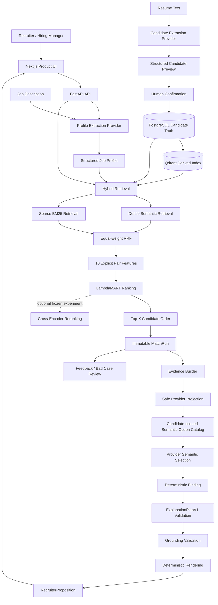

# PeopleMatch Agent Architecture

## Design goal

The system separates probabilistic language tasks from ranking ownership. LLM providers structure inputs and select candidate-scoped semantic options; deterministic retrieval, explicit features and LambdaMART decide candidate order. Code binds the selected options into the canonical ExplanationPlanV1, then grounding controls what may be displayed.

## Responsibility boundaries

| Component | Owns | Does not own |
| --- | --- | --- |
| Extraction provider | JD/Resume semantic structuring | Candidate order or ranking score |
| Dense retrieval | Semantic candidate recall | Final recommendation order |
| Sparse retrieval | Exact technical-term recall | Final recommendation order |
| RRF | First-stage retrieval fusion | Learned relevance ordering |
| Feature engineering | Frozen candidate/job pair signals | Free-form interpretation |
| LambdaMART | Default final candidate order and raw margin | Natural-language explanation |
| Cross-Encoder | Optional experimental shortlist reorder | Default product order |
| Evidence builder | Historical facts and ownership | New candidate facts |
| Explanation provider | Candidate-scoped semantic option selection | Rank, identity, evidence refs, structural binding or unsupported facts |
| Deterministic binder | Canonical ExplanationPlanV1 assembly from validated handles | New candidate facts or invented sources |
| Grounding validator | Evidence-reference integrity | Provider fallback or fact invention |

## Data and state

### PostgreSQL

The source of truth for Candidate/Job profiles, MatchRuns, match results, explanations, feedback and Bad Cases.

### Qdrant

A rebuildable derived vector index. It does not replace the structured profile truth stored in PostgreSQL.

### Redis

Present in the local infrastructure contract; the `portfolio-demo` product workflow does not depend on Redis business state.

### Model artifacts

The frozen LambdaMART model and feature metadata determine ranking compatibility. Startup must not silently substitute a missing or incompatible model.

## Runtime data flow

1. The JD is validated and parsed into a `JobProfile`.
2. Dense and Sparse retrievers query the same candidate corpus.
3. Equal-weight RRF creates the first-stage pool.
4. Ten frozen explicit features are calculated for each candidate/job pair.
5. LambdaMART produces raw margins and the default Top-K order.
6. MatchRun persists ordering, scores, provenance and evidence ownership.
7. A safe projection and candidate-scoped option catalog expose bounded, source-verified semantic choices to the provider.
8. The provider selects options; application validation rejects unknown, duplicate, wrong-type and cross-candidate handles. It does not ask the model to copy ranks, evidence refs or structural relationships.
9. The deterministic binder builds ExplanationPlanV1. Schema, provenance, candidate-isolation and grounding validation fail closed before render and persistence.
10. The persisted explanation and canonical RecruiterProposition read the historical MatchRun without altering ranking.

## Invariants

- Explanation generation cannot alter Candidate ordering, LTR score or ranking fingerprint.
- Provider failure does not authorize fallback ranking or fabricated success.
- Feedback and Bad Cases are observations, not automatic training labels.
- Cross-Encoder results do not replace the default LambdaMART product order.
- Phase 11 evaluation data and results remain frozen independently of runtime candidate ingestion.

## Provider boundary

Extraction and Explanation remain separate task domains while sharing the OpenAI-compatible transport. Each task can use deterministic mock or `openai_compatible` configuration independently. API keys remain backend environment variables and are never part of frontend state, screenshots, MatchRuns or evaluation artifacts.

Free-text Recruiter Narrative is a separate experimental, human-review draft capability, not the trusted Explanation or RecruiterProposition path.
