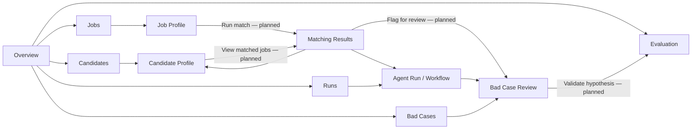
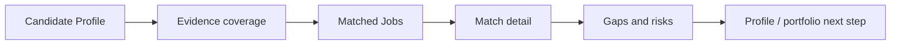
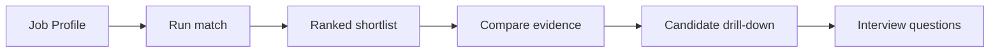
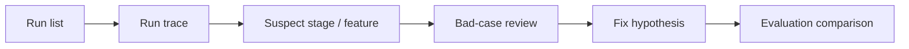
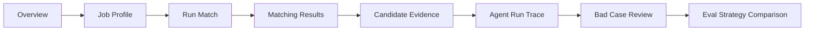

# Product Information Architecture

## Status and Boundary

This document defines the **planned product architecture** established in Phase 0.5A. It is not a database schema or API contract. Phase 0.5B implemented only the Matching Results design mock; the other described pages and all matching capabilities remain planned.

## Product Model

PeopleMatch Agent is organized around a decision record rather than a generic recruiting funnel. Profiles provide context, a match run produces a ranked result, evidence makes the result reviewable, and bad-case/evaluation records make later improvement traceable.

### Conceptual Entities

| Entity | Product responsibility | Important relationship |
|---|---|---|
| Candidate Profile | Candidate identity, direction, constraints, claims, and project evidence | Owns projects and evidence references; participates in match results |
| Project Evidence | Source-backed support for one or more capabilities | Links a candidate project to skills/tools without converting claims into proof |
| Job Profile | Role direction, stage, constraints, must-have and nice-to-have requirements | Provides the decision context for a match run |
| Match Run | Immutable context for strategy, versions, stages, status, and timing | Produces ranked match results and a trace |
| Match Result | Candidate/job rank, overall score, diagnostics, gaps, and risk | Belongs to one run; references ranking evidence and explanation separately |
| Ranking Evidence | Feature values, constraints, contributions, and source references | Explains ranking mechanics; cannot be rewritten by explanation |
| Explanation | Human-readable account grounded in ranking evidence | Describes an existing result; never changes rank |
| Run Step | One stage input/output/status record | Belongs to a match run and links failures to stages |
| Feedback | Explicit reviewer response linked to an immutable result | May create or enrich a bad case; does not mutate the original run |
| Bad Case | FP/FN classification, root cause, affected feature/stage, fix hypothesis | Links result, evidence, feedback, and later validation |
| Evaluation Run | Dataset/configuration-bound offline comparison | Compares strategies and links findings to bad-case slices |

These are product concepts only. Their formal domain contracts begin in later phases.

## Page Relationships



Matching Results is the central decision page. Candidate and Job Profiles are contextual evidence pages; Run, Bad Case, and Evaluation are progressively more technical diagnostic pages.

## Navigation Tree

```text
Overview
Profiles
├── Candidates
│   └── Candidate Profile
└── Jobs
    └── Job Profile
Matching
└── Matching Results
Runs
└── Agent Run / Workflow
Bad Cases
└── Bad Case Review
Evaluation
└── Evaluation Dashboard
```

The primary navigation stays at seven destinations. Detail pages are reached through lists and contextual links, not added as permanent navigation items.

## Page Responsibilities

| Page | Primary question | Primary object | Next best action |
|---|---|---|---|
| Overview | What can I inspect or run next? | System/product context | Open a job or recent run |
| Candidate Profile | What evidence supports this candidate's fit? | Candidate + project evidence | Inspect a contextual match |
| Job Profile | What does this role actually optimize for? | Job + requirements | Run match |
| Matching Results | Why is this the ranking? | Ranked shortlist | Inspect evidence or run trace |
| Agent Run | How was this result produced? | Match run + stages | Inspect failed/sensitive stage |
| Bad Case Review | Why was the recommendation wrong? | Attributed failure | Define a validation hypothesis |
| Evaluation Dashboard | Is one strategy better on the same local dataset? | Evaluation run comparison | Inspect a metric slice/bad case |

## Persona Flows

### Candidate / AI Builder



The candidate flow avoids a universal candidate score. Every assessment remains tied to a specific role, source evidence, and visible uncertainty.

### Recruiter / Founder / Hiring Team



The recruiter sees must-have coverage and evidence strength before generated explanation prose.

### Platform Operator



The operator flow preserves immutable run context so diagnosis cannot silently change history.

## Primary Demo Flow



### Demo Narrative

1. Define the role's direction and requirements.
2. Produce a shortlist under an explicit strategy.
3. Explain the rank using feature and project evidence.
4. Trace the stages that produced the decision.
5. Attribute one wrong recommendation to a feature/stage hypothesis.
6. Show how that hypothesis would be compared in a reproducible offline evaluation.

The demo should take 3–5 minutes and use one forward path. Overview appears only once.

## Context Preservation

The UI carries the following context between pages:

| Context | Visible representation | Persistence behavior |
|---|---|---|
| Job | Compact job summary | Remains while moving Results → Run → Bad Case |
| Candidate | Selected candidate and rank | Returns to the same shortlist position |
| Match run | Run ID, status, strategy | Links all evidence, trace, feedback, and bad-case views |
| Strategy | Named configuration/version | Remains visible in Results and Evaluation comparisons |

Context is shown as a compact strip or breadcrumb, not duplicated as a large nested card on every page.

## Route Intent

Exact Next.js routes are deferred until Phase 0.5B implementation planning, but route ownership should follow the product hierarchy:

- collection routes own filtering and selection;
- detail routes own evidence and contextual actions;
- match/run identifiers are durable deep-link anchors;
- comparison state that changes the meaning of a result must be explicit, not hidden only in transient client state.

No route is implemented by this document.
