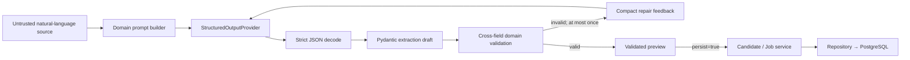

# Structured Profile Extraction

## Purpose

Phase 3 converts a supported synthetic natural-language candidate resume or job description into a validated, reviewable profile draft. It proves the extraction contract, failure handling, provenance boundary, and optional persistence path. It does not measure model accuracy and does not implement retrieval or ranking.

## Architecture



The provider proposes business fields. Pydantic validates them. The extraction service controls retry behavior and fingerprints. Server-side dependency wiring supplies an immutable trusted provider descriptor that owns provider metadata and provenance. Candidate/Job services inject identity and system metadata and own the atomic persistence boundary.

## Provider Boundary

`StructuredOutputProvider` is asynchronous and receives the task, clearly delimited source, exact draft JSON Schema, attempt number, and optional compact validation feedback. It returns raw text only. Provider name, kind, and `DataOrigin` come from the immutable descriptor selected by trusted dependency wiring, never from the provider response. The parser accepts only a complete JSON document through `json.loads`; Markdown fences, prose, substring extraction, `eval`, and permissive coercion are not accepted.

Phase 3 implements only `MockStructuredOutputProvider`. It maps SHA-256 fingerprints of four registered synthetic fixtures to deterministic JSON, performs no network or tool call, requires no secret, and returns `mock_input_not_supported` for unknown input. Tests can inject isolated response or exception sequences without global mutable state.

No real LLM provider is implemented in Phase 3. A future real provider must implement the same boundary; configuration never silently falls back to mock when an unknown provider is selected.

## Server-owned Fields

Candidate and job draft schemas exclude root identity, source, and provenance fields with `extra="forbid"`. A provider cannot set:

- `candidate_id` / `job_id`;
- `raw_text` / `raw_jd`;
- `data_origin`, `schema_version`, or `dataset_version`;
- dataset-only `archetype`.

When persistence is requested, the server injects the original request text byte-for-byte, generates `cand_parse_<uuid>` or `job_parse_<uuid>`, applies schema version `1.0`, and sets both `dataset_version` and `archetype` to `null`.

## Provenance

| Origin | Meaning | URL policy | Mutable through profile APIs |
|---|---|---|---|
| `synthetic_sandbox` | Frozen Phase 1 dataset record | `None`, `sandbox://`, or HTTP(S) with exact host `example.invalid` | No |
| `user_created` | Manual Phase 2 API creation | `None` or valid HTTP(S) | Yes |
| `mock_parsed` | Phase 3 deterministic mock extraction | Same restricted synthetic policy as the sandbox | Yes |
| `llm_parsed` | Reserved for a future real provider | `None` or valid HTTP(S) | Yes |

Mock dependency wiring uses the trusted `mock` / `mock_parsed` descriptor. Provider output cannot override this selection, so mock output is never labeled `llm_parsed`. Extending this Python enum does not require a migration because PostgreSQL stores `data_origin` in a string column.

## Hallucination Policy

Prompts require source-supported facts only and treat the source as untrusted data rather than instructions. They forbid browsing, URL fetching, tool calls, code execution, and invented skills, projects, outcomes, artifacts, locations, requirements, or experience. Candidate uncertainty is represented with `missing_fields` and `overclaim_risk`. If the canonical contract cannot represent a source honestly, extraction fails instead of weakening the Phase 1 schema.

Owner-local project, evidence, and requirement IDs are permitted. Draft validation reuses existing canonical nested models and record-level validators, including unique IDs, evidence-to-project references, evidence-to-claimed-skill references, enums, and origin-aware URL policy. Persistence-only BIGINT keys never enter prompts, drafts, or API records.

## Validation and Bounded Repair

The configured attempt count is one or two; the local default and maximum are two. Attempt 1 performs normal extraction. Invalid JSON or Pydantic/domain validation produces a compact field-level summary for one repair attempt. Repair is limited to the same source and contract and may not add unsupported facts. A second invalid response returns `provider_output_invalid`; it never writes a partial profile.

Provider exceptions and timeouts fail immediately with typed provider errors rather than entering an unbounded loop. Validation feedback contains no stack trace, SQL detail, environment value, secret, full internal object, or raw provider output.

## API Behavior

`POST /api/v1/candidates/parse` and `POST /api/v1/jobs/parse` accept:

```json
{
  "text": "synthetic natural-language input",
  "persist": false
}
```

`persist` defaults to `false`. A successful response contains the validated `draft`, nullable `record`, and extraction metadata: provider, provider kind, attempts, repaired, persisted, and SHA-256 input fingerprint. Preview makes no database write. Persistence begins only after complete draft validation and reuses the existing service/repository transaction path.

Errors use the shared response envelope:

- request/Pydantic validation: HTTP 422 `validation_error`;
- unregistered deterministic fixture: HTTP 422 `mock_input_not_supported`;
- provider exception: HTTP 503 `provider_unavailable`;
- timeout: HTTP 503 `provider_timeout`;
- repeated malformed or schema-invalid output: HTTP 502 `provider_output_invalid`.

Raw provider output and prompts are never returned by the API.

## Security and Privacy

Resume and JD text are potentially sensitive. The extraction path does not log source text, provider raw output, or full prompts. Normal response metadata uses only request ID, provider identity, task state, attempt count, and an input fingerprint. The mock has no tools and no network access. Prompt-injection tests verify the structured field/provenance boundary; they are not a claim of comprehensive prompt-injection security for a future real model.

## Synthetic Fixtures

- `candidate_matching_resume.txt` / `candidate_matching_output.json`
- `candidate_sparse_resume.txt` / `candidate_sparse_output.json`
- `job_matching_engineer.txt` / `job_matching_engineer_output.json`
- `job_sparse_ai_role.txt` / `job_sparse_ai_role_output.json`

These Phase 3 fixtures are fictional, live outside the frozen Phase 1 manifest, and exist only for deterministic architecture verification.

## Limitations

The mock supports only registered fixture text. It is not a resume parser, language model, extraction benchmark, or evidence of real-world accuracy. Phase 3 reports schema conformance, deterministic fixture behavior, bounded malformed-output recovery, persistence atomicity, and provenance safety—no extraction accuracy, recruiting impact, latency benchmark, or production claim.
